# off_tf08_w1: leaderboards

Top 10 methods on each metric. Full ranking by J: [`tables/off_tf08_w1.md`](../tables/off_tf08_w1.md). Archive overview: [`HIGHLIGHTS.md`](../HIGHLIGHTS.md).

## J (lower is better)

| rank | method | family | J |
|---|---|---|---|
| 1 | WLST+FirstFit | Heuristic | 129805 +/- 12950 |
| 2 | WLST+BestFit | Heuristic | 129805 +/- 12950 |
| 3 | WLST+WorstFit | Heuristic | 129805 +/- 12950 |
| 4 | WLST+Consolidate | Heuristic | 129805 +/- 12950 |
| 5 | LST+FirstFit | Heuristic | 129805 +/- 12950 |
| 6 | LST+BestFit | Heuristic | 129805 +/- 12950 |
| 7 | LST+Consolidate | Heuristic | 129805 +/- 12950 |
| 8 | LST+WorstFit | Heuristic | 129805 +/- 12950 |
| 9 | PPO Opt2 priority score windowed +EDF imitation warm start look-ahead fixed scaling arrival-aware critic lateness shaping reward scaling event-driven idle WLST expert | RL | 129805 +/- 0 |
| 10 | PPO Opt2 priority score windowed WLST expert +EDF imitation warm start look-ahead fixed scaling arrival-aware critic lateness shaping reward scaling event-driven idle | RL | 129805 +/- 0 |

| top 5 | top 10 |
|---|---|
| 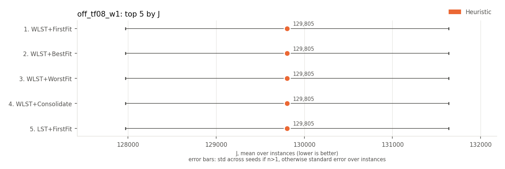 | 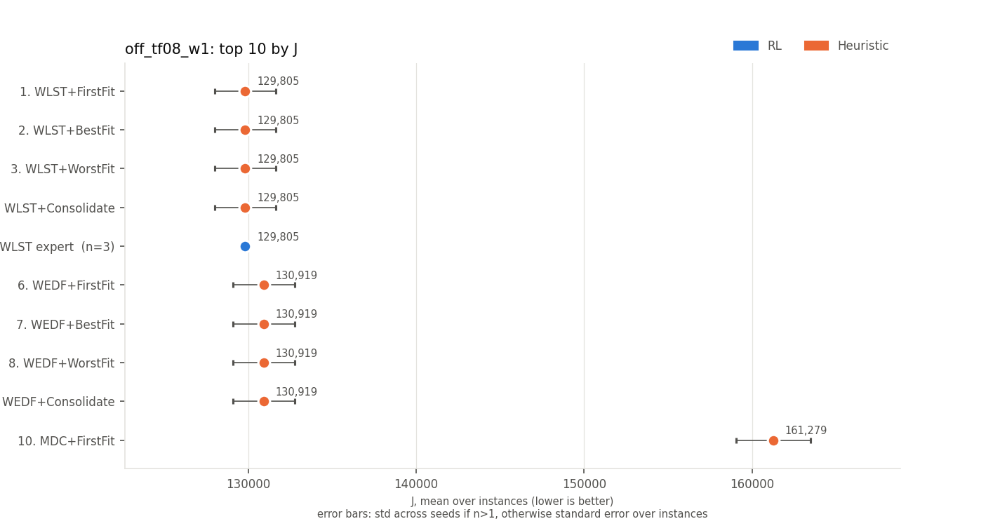 |

## on-time rate (higher is better)

| rank | method | family | on-time rate | J |
|---|---|---|---|---|
| 1 | WMDD+BestFit | Heuristic | 0.249 +/- 0.039 | 206958 +/- 14477 |
| 2 | WMDD+Consolidate | Heuristic | 0.249 +/- 0.039 | 206958 +/- 14477 |
| 3 | WMDD+FirstFit | Heuristic | 0.249 +/- 0.039 | 206958 +/- 14477 |
| 4 | WMDD+WorstFit | Heuristic | 0.249 +/- 0.039 | 206958 +/- 14477 |
| 5 | ATC+FirstFit | Heuristic | 0.243 +/- 0.039 | 210328 +/- 14586 |
| 6 | ATC+BestFit | Heuristic | 0.243 +/- 0.039 | 210328 +/- 14586 |
| 7 | ATC+Consolidate | Heuristic | 0.243 +/- 0.039 | 210328 +/- 14586 |
| 8 | ATC+WorstFit | Heuristic | 0.243 +/- 0.039 | 210328 +/- 14586 |
| 9 | COVERT+BestFit | Heuristic | 0.226 +/- 0.043 | 200736 +/- 14478 |
| 10 | COVERT+Consolidate | Heuristic | 0.226 +/- 0.043 | 200736 +/- 14478 |

| top 5 | top 10 |
|---|---|
| 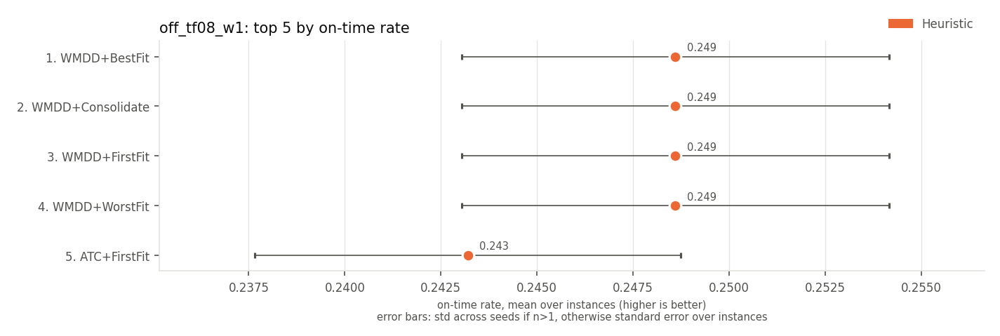 | 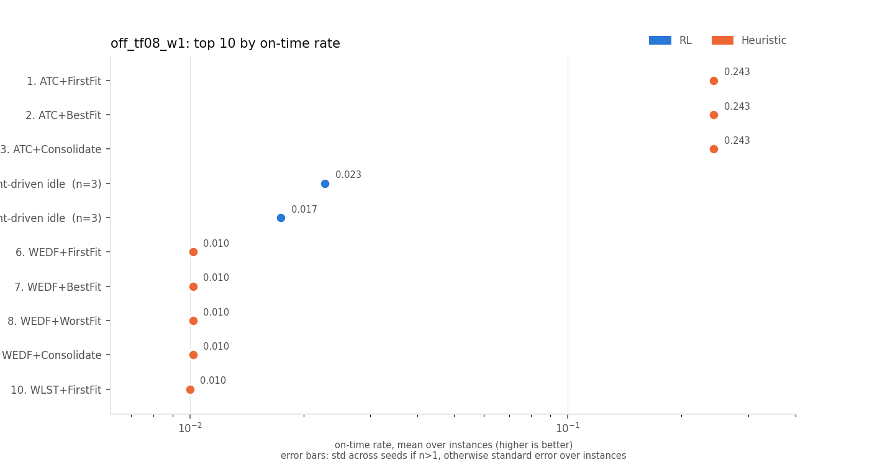 |

## late jobs (lower is better)

| rank | method | family | late jobs | J |
|---|---|---|---|---|
| 1 | WMDD+BestFit | Heuristic | 75.1 +/- 3.9 | 206958 +/- 14477 |
| 2 | WMDD+Consolidate | Heuristic | 75.1 +/- 3.9 | 206958 +/- 14477 |
| 3 | WMDD+FirstFit | Heuristic | 75.1 +/- 3.9 | 206958 +/- 14477 |
| 4 | WMDD+WorstFit | Heuristic | 75.1 +/- 3.9 | 206958 +/- 14477 |
| 5 | ATC+FirstFit | Heuristic | 75.7 +/- 3.9 | 210328 +/- 14586 |
| 6 | ATC+BestFit | Heuristic | 75.7 +/- 3.9 | 210328 +/- 14586 |
| 7 | ATC+Consolidate | Heuristic | 75.7 +/- 3.9 | 210328 +/- 14586 |
| 8 | ATC+WorstFit | Heuristic | 75.7 +/- 3.9 | 210328 +/- 14586 |
| 9 | COVERT+BestFit | Heuristic | 77.4 +/- 4.3 | 200736 +/- 14478 |
| 10 | COVERT+Consolidate | Heuristic | 77.4 +/- 4.3 | 200736 +/- 14478 |

| top 5 | top 10 |
|---|---|
| 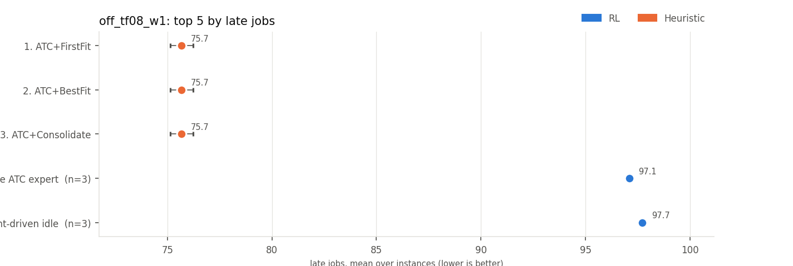 | 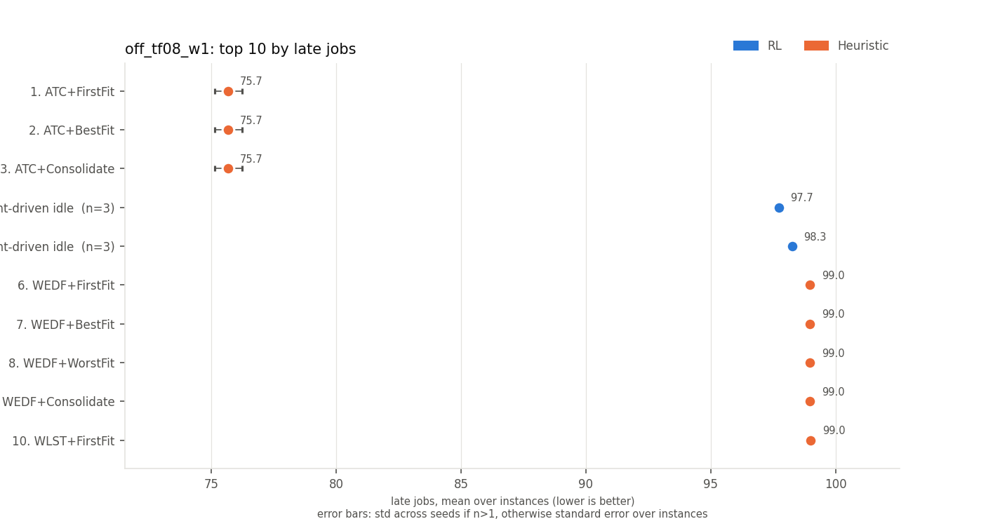 |

## weighted late jobs (lower is better)

| rank | method | family | weighted late jobs | J |
|---|---|---|---|---|
| 1 | WMDD+BestFit | Heuristic | 75.1 +/- 3.9 | 206958 +/- 14477 |
| 2 | WMDD+Consolidate | Heuristic | 75.1 +/- 3.9 | 206958 +/- 14477 |
| 3 | WMDD+FirstFit | Heuristic | 75.1 +/- 3.9 | 206958 +/- 14477 |
| 4 | WMDD+WorstFit | Heuristic | 75.1 +/- 3.9 | 206958 +/- 14477 |
| 5 | ATC+FirstFit | Heuristic | 75.7 +/- 3.9 | 210328 +/- 14586 |
| 6 | ATC+BestFit | Heuristic | 75.7 +/- 3.9 | 210328 +/- 14586 |
| 7 | ATC+Consolidate | Heuristic | 75.7 +/- 3.9 | 210328 +/- 14586 |
| 8 | ATC+WorstFit | Heuristic | 75.7 +/- 3.9 | 210328 +/- 14586 |
| 9 | COVERT+BestFit | Heuristic | 77.4 +/- 4.3 | 200736 +/- 14478 |
| 10 | COVERT+Consolidate | Heuristic | 77.4 +/- 4.3 | 200736 +/- 14478 |

| top 5 | top 10 |
|---|---|
| 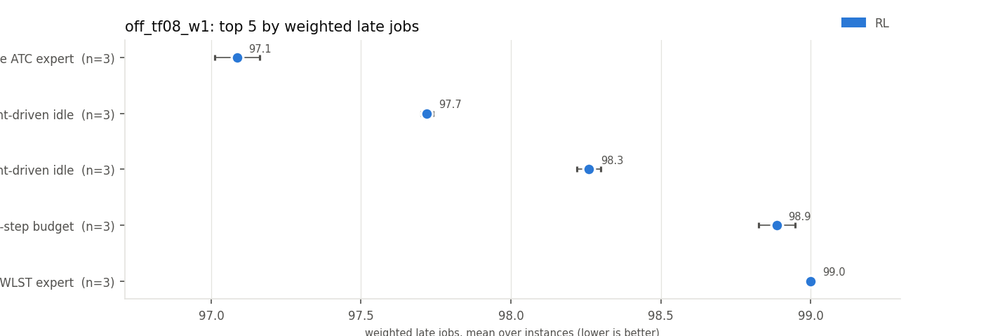 | 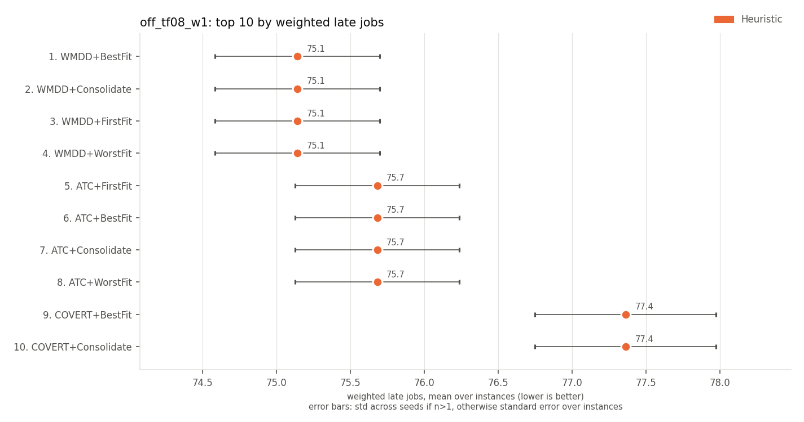 |

## weighted tardiness (lower is better)

| rank | method | family | weighted tardiness | J |
|---|---|---|---|---|
| 1 | PPO Opt2 priority score windowed +EDF imitation warm start look-ahead fixed scaling arrival-aware critic lateness shaping reward scaling event-driven idle WLST expert | RL | 3283 +/- 0 | 129805 +/- 0 |
| 2 | PPO Opt2 priority score windowed WLST expert +EDF imitation warm start look-ahead fixed scaling arrival-aware critic lateness shaping reward scaling event-driven idle | RL | 3283 +/- 0 | 129805 +/- 0 |
| 3 | PPO Opt2 priority score windowed +EDF imitation warm start look-ahead fixed scaling arrival-aware critic lateness shaping reward scaling event-driven idle EDFL expert | RL | 3283 +/- 0 | 130671 +/- 0 |
| 4 | WLST+FirstFit | Heuristic | 3283 +/- 171 | 129805 +/- 12950 |
| 5 | WLST+BestFit | Heuristic | 3283 +/- 171 | 129805 +/- 12950 |
| 6 | WLST+WorstFit | Heuristic | 3283 +/- 171 | 129805 +/- 12950 |
| 7 | WLST+Consolidate | Heuristic | 3283 +/- 171 | 129805 +/- 12950 |
| 8 | LST+FirstFit | Heuristic | 3283 +/- 171 | 129805 +/- 12950 |
| 9 | LST+BestFit | Heuristic | 3283 +/- 171 | 129805 +/- 12950 |
| 10 | LST+Consolidate | Heuristic | 3283 +/- 171 | 129805 +/- 12950 |

| top 5 | top 10 |
|---|---|
| 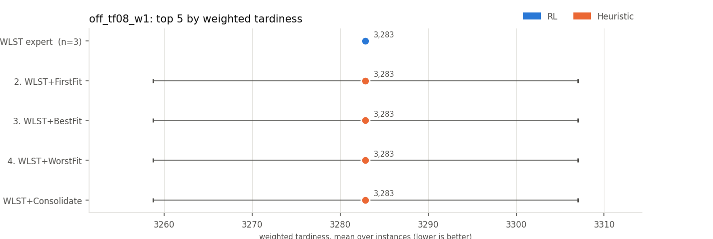 | 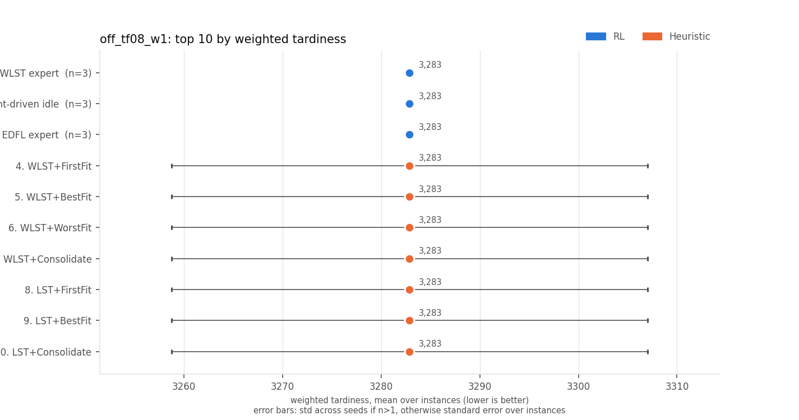 |

## max tardiness (lower is better)

| rank | method | family | max tardiness | J |
|---|---|---|---|---|
| 1 | WLST+FirstFit | Heuristic | 53.9 +/- 1.5 | 129805 +/- 12950 |
| 2 | WLST+BestFit | Heuristic | 53.9 +/- 1.5 | 129805 +/- 12950 |
| 3 | WLST+WorstFit | Heuristic | 53.9 +/- 1.5 | 129805 +/- 12950 |
| 4 | WLST+Consolidate | Heuristic | 53.9 +/- 1.5 | 129805 +/- 12950 |
| 5 | LST+FirstFit | Heuristic | 53.9 +/- 1.5 | 129805 +/- 12950 |
| 6 | LST+BestFit | Heuristic | 53.9 +/- 1.5 | 129805 +/- 12950 |
| 7 | LST+Consolidate | Heuristic | 53.9 +/- 1.5 | 129805 +/- 12950 |
| 8 | LST+WorstFit | Heuristic | 53.9 +/- 1.5 | 129805 +/- 12950 |
| 9 | PPO Opt2 priority score windowed +EDF imitation warm start look-ahead fixed scaling arrival-aware critic lateness shaping reward scaling event-driven idle WLST expert | RL | 53.9 +/- 0.0 | 129805 +/- 0 |
| 10 | PPO Opt2 priority score windowed WLST expert +EDF imitation warm start look-ahead fixed scaling arrival-aware critic lateness shaping reward scaling event-driven idle | RL | 53.9 +/- 0.0 | 129805 +/- 0 |

| top 5 | top 10 |
|---|---|
| 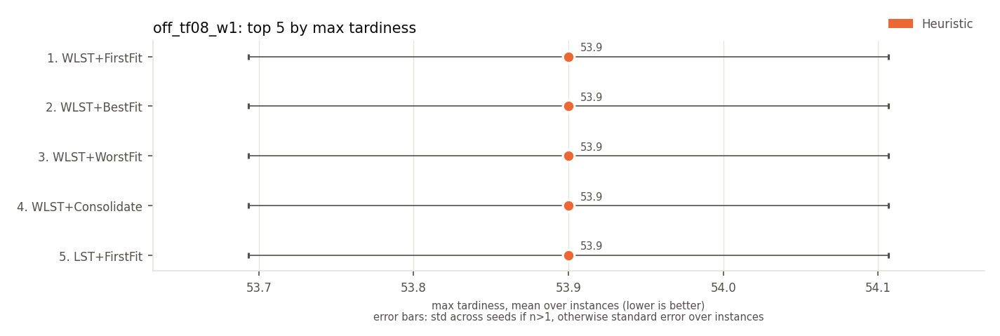 | 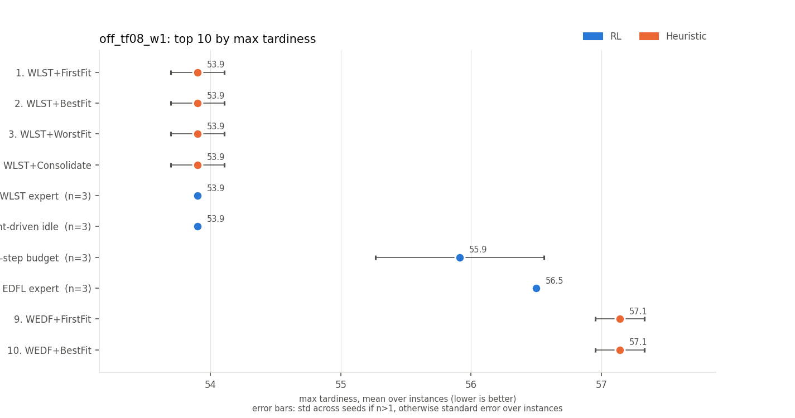 |

## p95 tardiness (lower is better)

| rank | method | family | p95 tardiness | J |
|---|---|---|---|---|
| 1 | WLST+FirstFit | Heuristic | 52.3 +/- 1.5 | 129805 +/- 12950 |
| 2 | WLST+BestFit | Heuristic | 52.3 +/- 1.5 | 129805 +/- 12950 |
| 3 | WLST+WorstFit | Heuristic | 52.3 +/- 1.5 | 129805 +/- 12950 |
| 4 | WLST+Consolidate | Heuristic | 52.3 +/- 1.5 | 129805 +/- 12950 |
| 5 | LST+FirstFit | Heuristic | 52.3 +/- 1.5 | 129805 +/- 12950 |
| 6 | LST+BestFit | Heuristic | 52.3 +/- 1.5 | 129805 +/- 12950 |
| 7 | LST+Consolidate | Heuristic | 52.3 +/- 1.5 | 129805 +/- 12950 |
| 8 | LST+WorstFit | Heuristic | 52.3 +/- 1.5 | 129805 +/- 12950 |
| 9 | PPO Opt2 priority score windowed +EDF imitation warm start look-ahead fixed scaling arrival-aware critic lateness shaping reward scaling event-driven idle WLST expert | RL | 52.3 +/- 0.0 | 129805 +/- 0 |
| 10 | PPO Opt2 priority score windowed WLST expert +EDF imitation warm start look-ahead fixed scaling arrival-aware critic lateness shaping reward scaling event-driven idle | RL | 52.3 +/- 0.0 | 129805 +/- 0 |

| top 5 | top 10 |
|---|---|
| 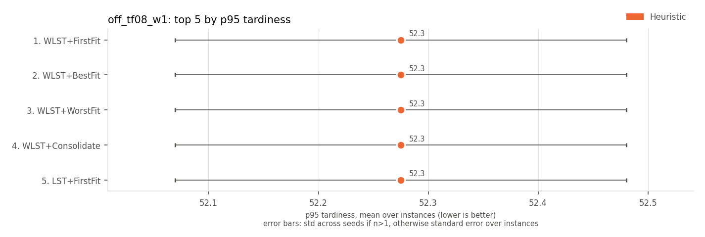 | 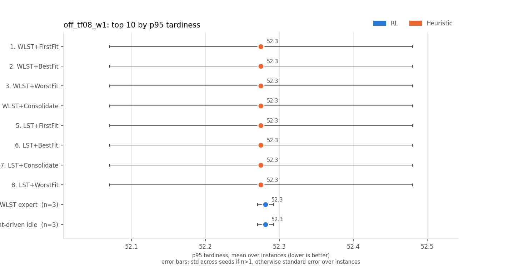 |

## mean wait (lower is better)

| rank | method | family | mean wait | J |
|---|---|---|---|---|
| 1 | WLST+FirstFit | Heuristic | 49.50 +/- 0.00 | 129805 +/- 12950 |
| 2 | WLST+BestFit | Heuristic | 49.50 +/- 0.00 | 129805 +/- 12950 |
| 3 | WLST+WorstFit | Heuristic | 49.50 +/- 0.00 | 129805 +/- 12950 |
| 4 | WLST+Consolidate | Heuristic | 49.50 +/- 0.00 | 129805 +/- 12950 |
| 5 | LST+FirstFit | Heuristic | 49.50 +/- 0.00 | 129805 +/- 12950 |
| 6 | LST+BestFit | Heuristic | 49.50 +/- 0.00 | 129805 +/- 12950 |
| 7 | LST+Consolidate | Heuristic | 49.50 +/- 0.00 | 129805 +/- 12950 |
| 8 | LST+WorstFit | Heuristic | 49.50 +/- 0.00 | 129805 +/- 12950 |
| 9 | PPO Opt2 priority score windowed +EDF imitation warm start look-ahead fixed scaling arrival-aware critic lateness shaping reward scaling event-driven idle WLST expert | RL | 49.50 +/- 0.00 | 129805 +/- 0 |
| 10 | PPO Opt2 priority score windowed WLST expert +EDF imitation warm start look-ahead fixed scaling arrival-aware critic lateness shaping reward scaling event-driven idle | RL | 49.50 +/- 0.00 | 129805 +/- 0 |

| top 5 | top 10 |
|---|---|
| 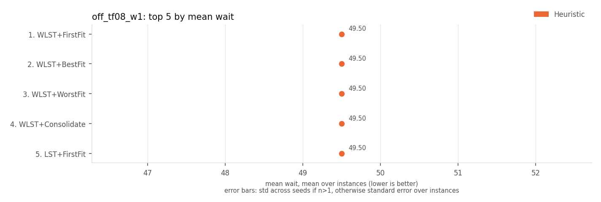 | 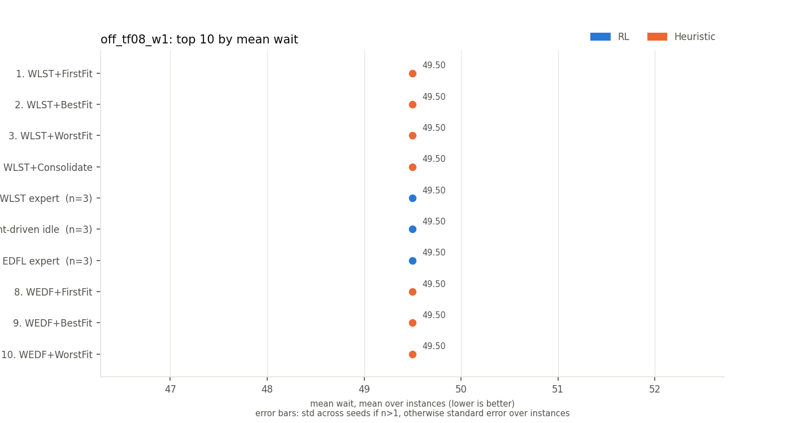 |

## mean flow time (lower is better)

| rank | method | family | mean flow time | J |
|---|---|---|---|---|
| 1 | PPO Opt2 priority score windowed +EDF imitation warm start look-ahead fixed scaling arrival-aware critic lateness shaping reward scaling event-driven idle WLST expert | RL | 54.54 +/- 0.00 | 129805 +/- 0 |
| 2 | PPO Opt2 priority score windowed WLST expert +EDF imitation warm start look-ahead fixed scaling arrival-aware critic lateness shaping reward scaling event-driven idle | RL | 54.54 +/- 0.00 | 129805 +/- 0 |
| 3 | PPO Opt2 priority score windowed +EDF imitation warm start look-ahead fixed scaling arrival-aware critic lateness shaping reward scaling event-driven idle EDFL expert | RL | 54.54 +/- 0.00 | 130671 +/- 0 |
| 4 | PPO Opt3 ATC-prior score windowed look-ahead fixed scaling arrival-aware critic lateness shaping reward scaling event-driven idle 1M-step budget | RL | 54.54 +/- 0.00 | 130680 +/- 215 |
| 5 | PPO Opt2 priority score windowed MDC expert +EDF imitation warm start look-ahead fixed scaling arrival-aware critic lateness shaping reward scaling event-driven idle | RL | 54.54 +/- 0.00 | 152000 +/- 19 |
| 6 | PPO Opt2 priority score windowed COVERT expert +EDF imitation warm start look-ahead fixed scaling arrival-aware critic lateness shaping reward scaling event-driven idle | RL | 54.54 +/- 0.00 | 168539 +/- 1 |
| 7 | PPO Opt2 priority score windowed look-ahead fixed scaling arrival-aware critic lateness shaping reward scaling event-driven idle +late-count objective 1M-step budget [lambda x4] | RL | 54.54 +/- 0.00 | 169137 +/- 22671 |
| 8 | PPO Opt3 ATC-prior score windowed +EDF imitation warm start look-ahead fixed scaling arrival-aware critic lateness shaping reward scaling event-driven idle ATC expert | RL | 54.54 +/- 0.00 | 173184 +/- 458 |
| 9 | PPO Opt2 priority score windowed look-ahead fixed scaling arrival-aware critic lateness shaping reward scaling event-driven idle +linear-tardiness objective +late-count objective +energy objective 1M-step budget [lambda x4] | RL | 54.54 +/- 0.00 | 182542 +/- 1564 |
| 10 | WLST+FirstFit | Heuristic | 54.54 +/- 0.27 | 129805 +/- 12950 |

| top 5 | top 10 |
|---|---|
| 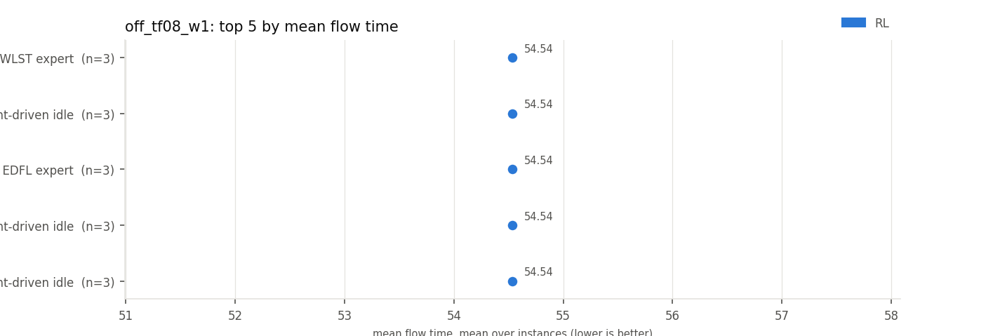 | 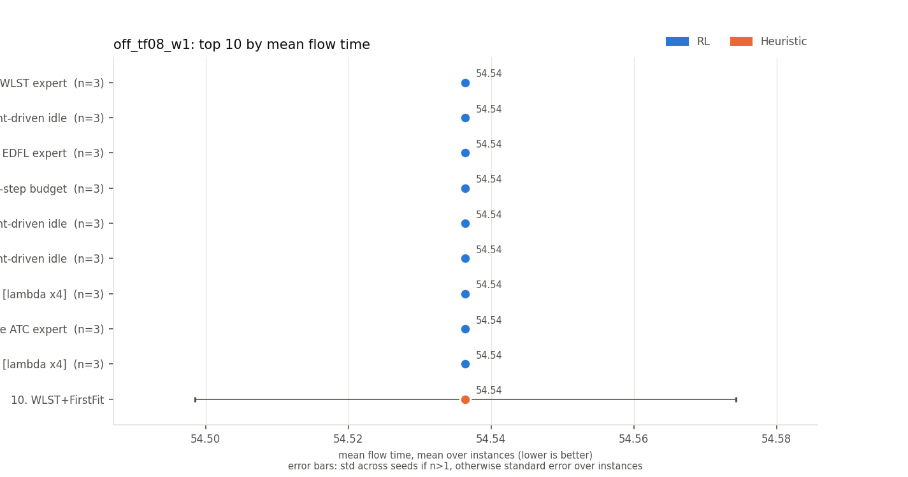 |

## makespan (lower is better)

| rank | method | family | makespan | J |
|---|---|---|---|---|
| 1 | LPT+BestFit | Heuristic | 100.0 +/- 0.0 | 199472 +/- 13643 |
| 2 | LPT+Consolidate | Heuristic | 100.0 +/- 0.0 | 199472 +/- 13643 |
| 3 | LPT+FirstFit | Heuristic | 100.0 +/- 0.0 | 199472 +/- 13643 |
| 4 | LPT+WorstFit | Heuristic | 100.0 +/- 0.0 | 199472 +/- 13643 |
| 5 | LST+FirstFit | Heuristic | 102.3 +/- 1.4 | 129805 +/- 12950 |
| 6 | LST+BestFit | Heuristic | 102.3 +/- 1.4 | 129805 +/- 12950 |
| 7 | LST+Consolidate | Heuristic | 102.3 +/- 1.4 | 129805 +/- 12950 |
| 8 | LST+WorstFit | Heuristic | 102.3 +/- 1.4 | 129805 +/- 12950 |
| 9 | WLST+FirstFit | Heuristic | 102.6 +/- 1.5 | 129805 +/- 12950 |
| 10 | WLST+BestFit | Heuristic | 102.6 +/- 1.5 | 129805 +/- 12950 |

| top 5 | top 10 |
|---|---|
| 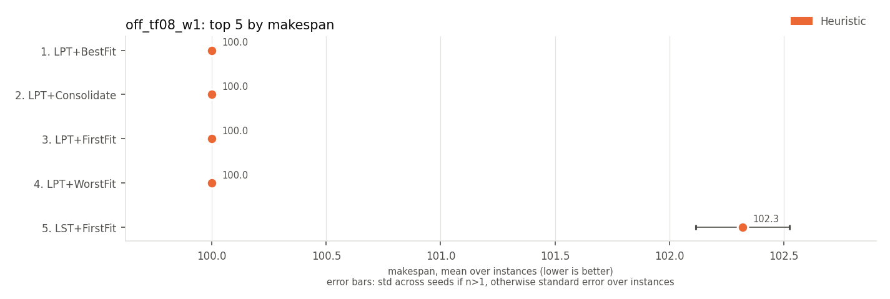 | 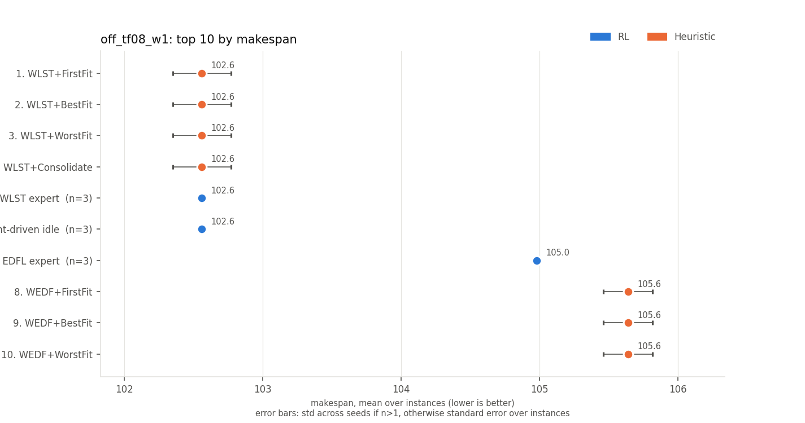 |

## utilisation of active machines (higher is better)

| rank | method | family | utilisation of active machines | J |
|---|---|---|---|---|
| 1 | LPT+Consolidate | Heuristic | 0.665 +/- 0.022 | 199472 +/- 13643 |
| 2 | WMDD+Consolidate | Heuristic | 0.654 +/- 0.024 | 206958 +/- 14477 |
| 3 | MDC+Consolidate | Heuristic | 0.654 +/- 0.021 | 161279 +/- 15663 |
| 4 | COVERT+Consolidate | Heuristic | 0.654 +/- 0.027 | 200736 +/- 14478 |
| 5 | ATC+Consolidate | Heuristic | 0.650 +/- 0.025 | 210328 +/- 14586 |
| 6 | LPT+BestFit | Heuristic | 0.648 +/- 0.025 | 199472 +/- 13643 |
| 7 | LST+Consolidate | Heuristic | 0.647 +/- 0.020 | 129805 +/- 12950 |
| 8 | SPT+Consolidate | Heuristic | 0.647 +/- 0.024 | 215769 +/- 14460 |
| 9 | WSPT+Consolidate | Heuristic | 0.647 +/- 0.024 | 215769 +/- 14460 |
| 10 | LPT+FirstFit | Heuristic | 0.647 +/- 0.022 | 199472 +/- 13643 |

| top 5 | top 10 |
|---|---|
| 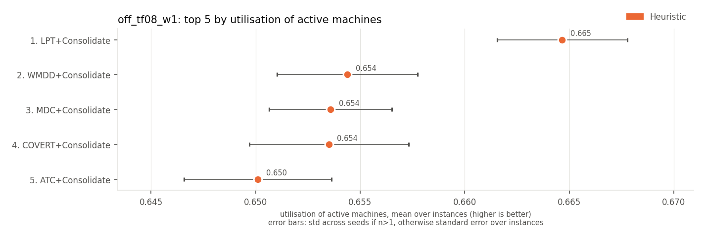 | 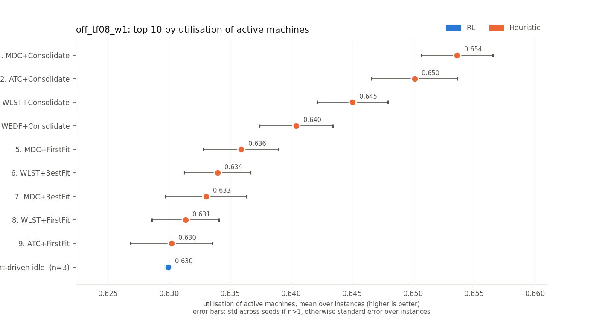 |

## active machine-ticks (lower is better)

| rank | method | family | active machine-ticks | J |
|---|---|---|---|---|
| 1 | LPT+Consolidate | Heuristic | 162 +/- 9 | 199472 +/- 13643 |
| 2 | WMDD+Consolidate | Heuristic | 165 +/- 7 | 206958 +/- 14477 |
| 3 | LPT+BestFit | Heuristic | 165 +/- 10 | 199472 +/- 13643 |
| 4 | MDC+Consolidate | Heuristic | 166 +/- 9 | 161279 +/- 15663 |
| 5 | LST+Consolidate | Heuristic | 166 +/- 9 | 129805 +/- 12950 |
| 6 | COVERT+Consolidate | Heuristic | 166 +/- 8 | 200736 +/- 14478 |
| 7 | LPT+FirstFit | Heuristic | 166 +/- 10 | 199472 +/- 13643 |
| 8 | ATC+Consolidate | Heuristic | 166 +/- 7 | 210328 +/- 14586 |
| 9 | SPT+Consolidate | Heuristic | 167 +/- 7 | 215769 +/- 14460 |
| 10 | WSPT+Consolidate | Heuristic | 167 +/- 7 | 215769 +/- 14460 |

| top 5 | top 10 |
|---|---|
| 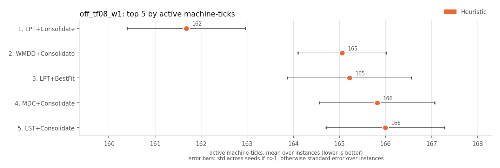 | 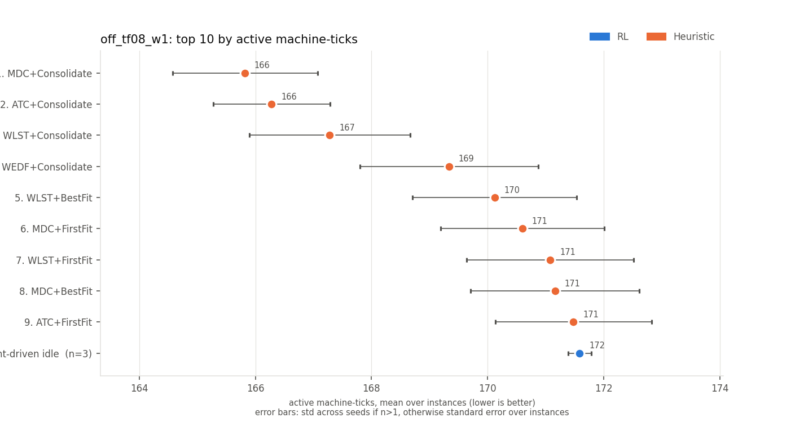 |

## energy (SPECpower) (lower is better)

| rank | method | family | energy (SPECpower) | J |
|---|---|---|---|---|
| 1 | LPT+Consolidate | Heuristic | 139 +/- 8 | 199472 +/- 13643 |
| 2 | WMDD+Consolidate | Heuristic | 141 +/- 7 | 206958 +/- 14477 |
| 3 | LPT+BestFit | Heuristic | 141 +/- 8 | 199472 +/- 13643 |
| 4 | MDC+Consolidate | Heuristic | 142 +/- 8 | 161279 +/- 15663 |
| 5 | LST+Consolidate | Heuristic | 142 +/- 8 | 129805 +/- 12950 |
| 6 | COVERT+Consolidate | Heuristic | 142 +/- 7 | 200736 +/- 14478 |
| 7 | LPT+FirstFit | Heuristic | 142 +/- 9 | 199472 +/- 13643 |
| 8 | ATC+Consolidate | Heuristic | 142 +/- 7 | 210328 +/- 14586 |
| 9 | FCFS+Consolidate | Heuristic | 143 +/- 9 | 206104 +/- 13101 |
| 10 | SPT+Consolidate | Heuristic | 143 +/- 7 | 215769 +/- 14460 |

| top 5 | top 10 |
|---|---|
| 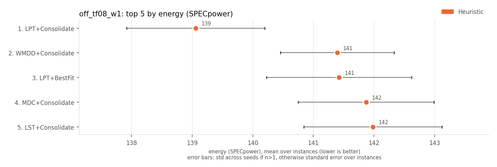 | 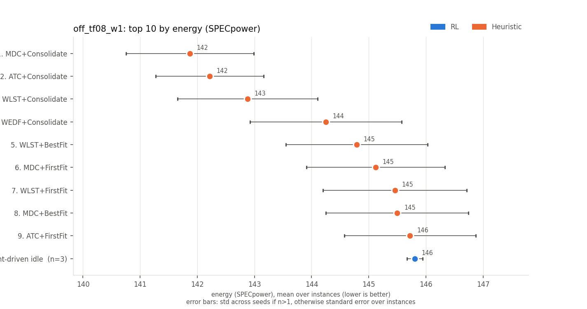 |

Spread (+/-): std across seeds for multi-seed RL rows, otherwise std across instances.
