# on_rho075: leaderboards

Top 10 methods on each metric. Full ranking by J: [`tables/on_rho075.md`](../tables/on_rho075.md). Archive overview: [`HIGHLIGHTS.md`](../HIGHLIGHTS.md).

## J (lower is better)

| rank | method | family | J |
|---|---|---|---|
| 1 | WLST+Consolidate | Heuristic | 5990 +/- 3881 |
| 2 | PPO Opt2 priority score +Consolidate windowed MDC expert +EDF imitation warm start look-ahead fixed scaling arrival-aware critic lateness shaping reward scaling event-driven idle | RL | 6045 +/- 51 |
| 3 | LST+Consolidate | Heuristic | 6051 +/- 4035 |
| 4 | MDC+Consolidate | Heuristic | 6068 +/- 4037 |
| 5 | PPO Opt2 priority score +Consolidate +EDF imitation warm start look-ahead fixed scaling arrival-aware critic lateness shaping reward scaling event-driven idle WLST expert | RL | 6092 +/- 61 |
| 6 | PPO Opt2 priority score +Consolidate windowed COVERT expert +EDF imitation warm start look-ahead fixed scaling arrival-aware critic lateness shaping reward scaling event-driven idle | RL | 6122 +/- 117 |
| 7 | PPO Opt2 priority score +Consolidate windowed +EDF imitation warm start look-ahead fixed scaling arrival-aware critic lateness shaping reward scaling event-driven idle 1M-step budget WLST expert | RL | 6129 +/- 116 |
| 8 | MDC+FirstFit | Heuristic | 6149 +/- 4064 |
| 9 | PPO Opt2 priority score +Consolidate windowed +EDF imitation warm start look-ahead fixed scaling arrival-aware critic lateness shaping reward scaling event-driven idle WLST expert | RL | 6157 +/- 93 |
| 10 | PPO Opt2 priority score +Consolidate windowed +EDF imitation warm start look-ahead fixed scaling arrival-aware critic lateness shaping reward scaling event-driven idle EDFL expert | RL | 6163 +/- 54 |

| top 5 | top 10 |
|---|---|
| 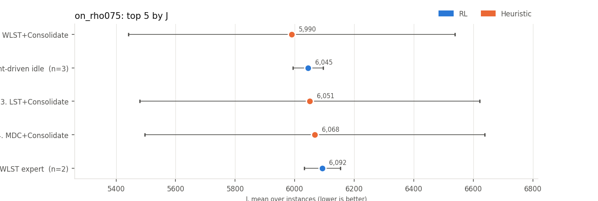 | 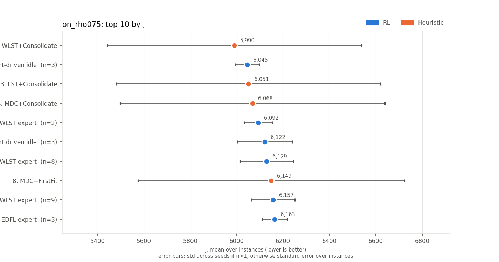 |

## on-time rate (higher is better)

| rank | method | family | on-time rate | J |
|---|---|---|---|---|
| 1 | MDC+Consolidate | Heuristic | 0.977 +/- 0.005 | 6068 +/- 4037 |
| 2 | LST+Consolidate | Heuristic | 0.977 +/- 0.005 | 6051 +/- 4035 |
| 3 | COVERT+Consolidate | Heuristic | 0.977 +/- 0.005 | 6219 +/- 4449 |
| 4 | PPO Opt2 priority score +Consolidate windowed MDC expert +EDF imitation warm start look-ahead fixed scaling arrival-aware critic lateness shaping reward scaling event-driven idle | RL | 0.977 +/- 0.000 | 6045 +/- 51 |
| 5 | PPO Opt2 priority score +Consolidate windowed +EDF imitation warm start look-ahead fixed scaling arrival-aware critic lateness shaping reward scaling event-driven idle EDFL expert | RL | 0.977 +/- 0.000 | 6163 +/- 54 |
| 6 | PPO Opt2 priority score +Consolidate windowed COVERT expert +EDF imitation warm start look-ahead fixed scaling arrival-aware critic lateness shaping reward scaling event-driven idle | RL | 0.976 +/- 0.000 | 6122 +/- 117 |
| 7 | WLST+Consolidate | Heuristic | 0.976 +/- 0.005 | 5990 +/- 3881 |
| 8 | EDF+Consolidate | Heuristic | 0.976 +/- 0.006 | 6181 +/- 4022 |
| 9 | PPO Opt2 priority score +Consolidate +EDF imitation warm start look-ahead fixed scaling arrival-aware critic lateness shaping reward scaling event-driven idle WLST expert | RL | 0.976 +/- 0.000 | 6092 +/- 61 |
| 10 | PPO Opt2 priority score +Consolidate windowed +EDF imitation warm start look-ahead fixed scaling arrival-aware critic lateness shaping reward scaling event-driven idle 1M-step budget WLST expert | RL | 0.976 +/- 0.001 | 6129 +/- 116 |

| top 5 | top 10 |
|---|---|
| 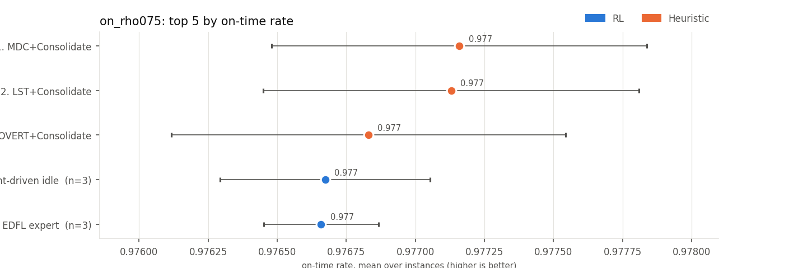 | 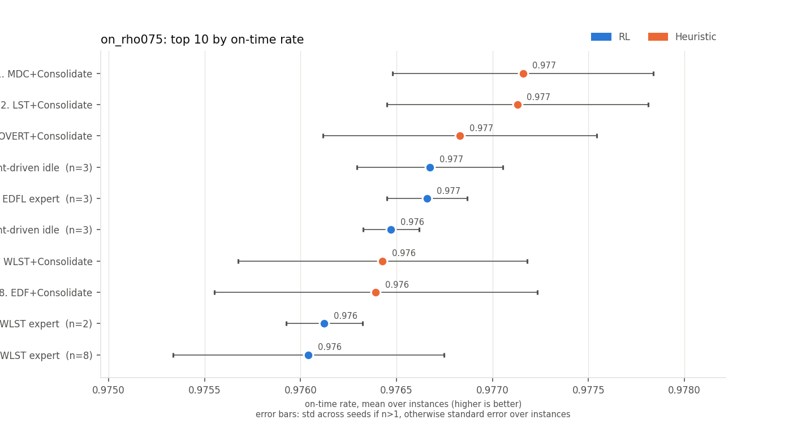 |

## late jobs (lower is better)

| rank | method | family | late jobs | J |
|---|---|---|---|---|
| 1 | MDC+Consolidate | Heuristic | 16.3 +/- 3.5 | 6068 +/- 4037 |
| 2 | LST+Consolidate | Heuristic | 16.4 +/- 3.5 | 6051 +/- 4035 |
| 3 | COVERT+Consolidate | Heuristic | 16.6 +/- 3.7 | 6219 +/- 4449 |
| 4 | PPO Opt2 priority score +Consolidate windowed MDC expert +EDF imitation warm start look-ahead fixed scaling arrival-aware critic lateness shaping reward scaling event-driven idle | RL | 16.7 +/- 0.3 | 6045 +/- 51 |
| 5 | PPO Opt2 priority score +Consolidate windowed +EDF imitation warm start look-ahead fixed scaling arrival-aware critic lateness shaping reward scaling event-driven idle EDFL expert | RL | 16.7 +/- 0.2 | 6163 +/- 54 |
| 6 | PPO Opt2 priority score +Consolidate windowed COVERT expert +EDF imitation warm start look-ahead fixed scaling arrival-aware critic lateness shaping reward scaling event-driven idle | RL | 16.8 +/- 0.1 | 6122 +/- 117 |
| 7 | WLST+Consolidate | Heuristic | 16.9 +/- 4.0 | 5990 +/- 3881 |
| 8 | EDF+Consolidate | Heuristic | 16.9 +/- 4.4 | 6181 +/- 4022 |
| 9 | PPO Opt2 priority score +Consolidate +EDF imitation warm start look-ahead fixed scaling arrival-aware critic lateness shaping reward scaling event-driven idle WLST expert | RL | 17.1 +/- 0.1 | 6092 +/- 61 |
| 10 | PPO Opt2 priority score +Consolidate windowed +EDF imitation warm start look-ahead fixed scaling arrival-aware critic lateness shaping reward scaling event-driven idle 1M-step budget WLST expert | RL | 17.2 +/- 0.5 | 6129 +/- 116 |

| top 5 | top 10 |
|---|---|
| 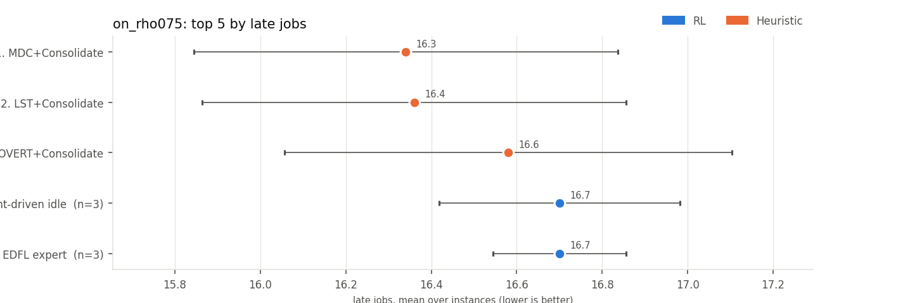 | 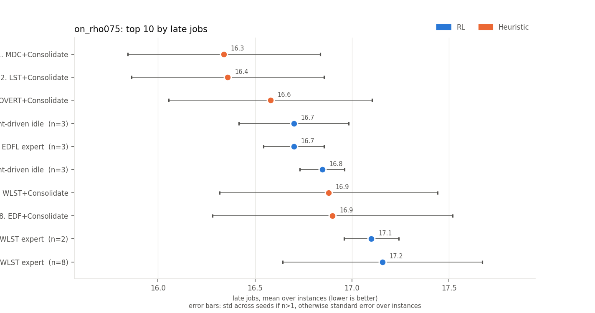 |

## weighted late jobs (lower is better)

| rank | method | family | weighted late jobs | J |
|---|---|---|---|---|
| 1 | MDC+Consolidate | Heuristic | 50.1 +/- 12.4 | 6068 +/- 4037 |
| 2 | LST+Consolidate | Heuristic | 50.2 +/- 12.4 | 6051 +/- 4035 |
| 3 | COVERT+Consolidate | Heuristic | 50.6 +/- 12.6 | 6219 +/- 4449 |
| 4 | PPO Opt2 priority score +Consolidate windowed +EDF imitation warm start look-ahead fixed scaling arrival-aware critic lateness shaping reward scaling event-driven idle EDFL expert | RL | 50.9 +/- 0.6 | 6163 +/- 54 |
| 5 | WLST+Consolidate | Heuristic | 51.0 +/- 14.2 | 5990 +/- 3881 |
| 6 | PPO Opt2 priority score +Consolidate windowed MDC expert +EDF imitation warm start look-ahead fixed scaling arrival-aware critic lateness shaping reward scaling event-driven idle | RL | 51.0 +/- 0.8 | 6045 +/- 51 |
| 7 | PPO Opt2 priority score +Consolidate +EDF imitation warm start look-ahead fixed scaling arrival-aware critic lateness shaping reward scaling event-driven idle WLST expert | RL | 51.3 +/- 0.2 | 6092 +/- 61 |
| 8 | PPO Opt2 priority score +Consolidate windowed COVERT expert +EDF imitation warm start look-ahead fixed scaling arrival-aware critic lateness shaping reward scaling event-driven idle | RL | 51.4 +/- 0.3 | 6122 +/- 117 |
| 9 | PPO Opt3 ATC-prior score +Consolidate windowed +EDF imitation warm start look-ahead fixed scaling arrival-aware critic lateness shaping reward scaling event-driven idle ATC expert | RL | 51.4 +/- 0.4 | 7177 +/- 117 |
| 10 | ATC+Consolidate | Heuristic | 51.5 +/- 13.8 | 7109 +/- 5514 |

| top 5 | top 10 |
|---|---|
| 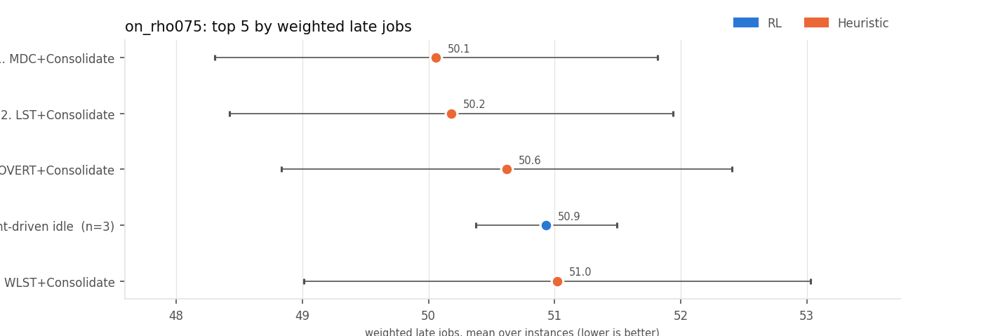 | 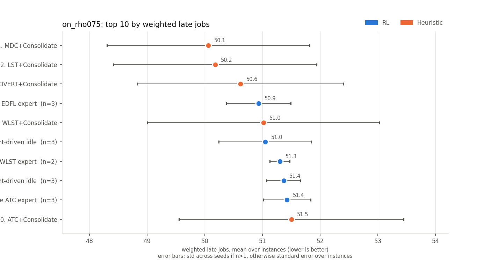 |

## weighted tardiness (lower is better)

| rank | method | family | weighted tardiness | J |
|---|---|---|---|---|
| 1 | WLST+Consolidate | Heuristic | 414 +/- 181 | 5990 +/- 3881 |
| 2 | LST+Consolidate | Heuristic | 414 +/- 184 | 6051 +/- 4035 |
| 3 | MDC+Consolidate | Heuristic | 414 +/- 184 | 6068 +/- 4037 |
| 4 | PPO Opt2 priority score +Consolidate windowed MDC expert +EDF imitation warm start look-ahead fixed scaling arrival-aware critic lateness shaping reward scaling event-driven idle | RL | 415 +/- 4 | 6045 +/- 51 |
| 5 | COVERT+Consolidate | Heuristic | 419 +/- 188 | 6219 +/- 4449 |
| 6 | PPO Opt2 priority score +Consolidate +EDF imitation warm start look-ahead fixed scaling arrival-aware critic lateness shaping reward scaling event-driven idle WLST expert | RL | 419 +/- 3 | 6092 +/- 61 |
| 7 | PPO Opt2 priority score +Consolidate windowed +EDF imitation warm start look-ahead fixed scaling arrival-aware critic lateness shaping reward scaling event-driven idle EDFL expert | RL | 420 +/- 3 | 6163 +/- 54 |
| 8 | PPO Opt2 priority score +Consolidate windowed COVERT expert +EDF imitation warm start look-ahead fixed scaling arrival-aware critic lateness shaping reward scaling event-driven idle | RL | 421 +/- 6 | 6122 +/- 117 |
| 9 | PPO Opt2 priority score +Consolidate windowed +EDF imitation warm start look-ahead fixed scaling arrival-aware critic lateness shaping reward scaling event-driven idle 1M-step budget WLST expert | RL | 421 +/- 8 | 6129 +/- 116 |
| 10 | PPO Opt2 priority score +Consolidate windowed +EDF imitation warm start look-ahead fixed scaling arrival-aware critic lateness shaping reward scaling event-driven idle WLST expert | RL | 424 +/- 4 | 6157 +/- 93 |

| top 5 | top 10 |
|---|---|
| 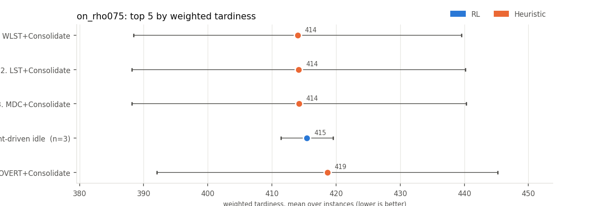 | 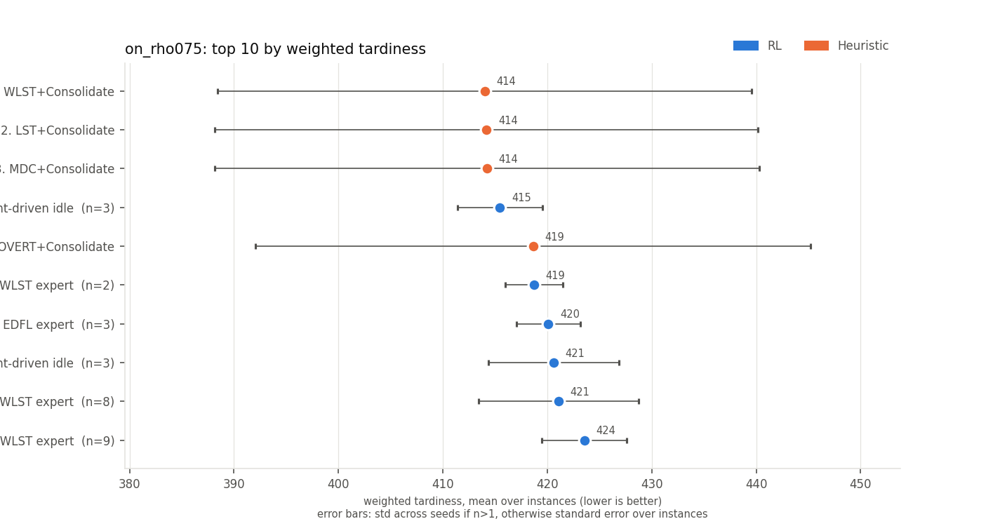 |

## max tardiness (lower is better)

| rank | method | family | max tardiness | J |
|---|---|---|---|---|
| 1 | WLST+BestFit | Heuristic | 23.8 +/- 5.0 | 6210 +/- 4129 |
| 2 | PPO Opt2 priority score +Consolidate windowed +EDF imitation warm start look-ahead fixed scaling arrival-aware critic lateness shaping reward scaling event-driven idle WLST expert | RL | 23.8 +/- 0.1 | 6157 +/- 93 |
| 3 | PPO Opt2 priority score +Consolidate windowed MDC expert +EDF imitation warm start look-ahead fixed scaling arrival-aware critic lateness shaping reward scaling event-driven idle | RL | 23.8 +/- 0.1 | 6045 +/- 51 |
| 4 | LST+Consolidate | Heuristic | 23.9 +/- 5.2 | 6051 +/- 4035 |
| 5 | MDC+Consolidate | Heuristic | 23.9 +/- 5.2 | 6068 +/- 4037 |
| 6 | PPO Opt2 priority score +Consolidate windowed +EDF imitation warm start look-ahead fixed scaling arrival-aware critic lateness shaping reward scaling event-driven idle 1M-step budget WLST expert | RL | 23.9 +/- 0.1 | 6129 +/- 116 |
| 7 | PPO Opt2 priority score +Consolidate windowed WLST expert +EDF imitation warm start look-ahead fixed scaling arrival-aware critic lateness shaping reward scaling event-driven idle | RL | 23.9 +/- 0.2 | 6174 +/- 152 |
| 8 | WLST+FirstFit | Heuristic | 23.9 +/- 5.0 | 6204 +/- 4086 |
| 9 | LST+BestFit | Heuristic | 23.9 +/- 5.0 | 6323 +/- 4374 |
| 10 | PPO Opt2 priority score +Consolidate windowed COVERT expert +EDF imitation warm start look-ahead fixed scaling arrival-aware critic lateness shaping reward scaling event-driven idle | RL | 24.0 +/- 0.2 | 6122 +/- 117 |

| top 5 | top 10 |
|---|---|
| 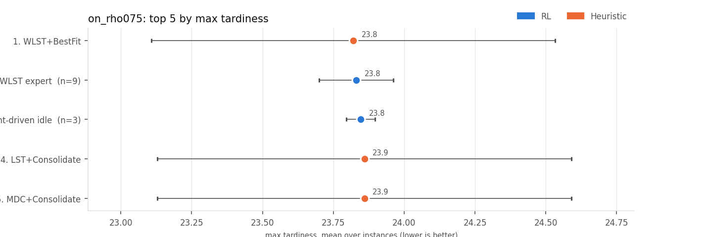 | 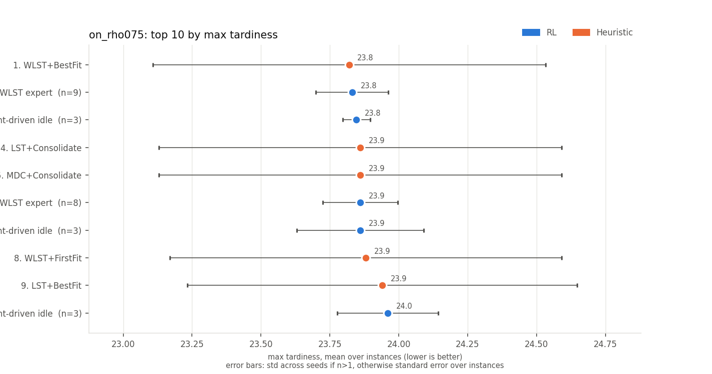 |

## p95 tardiness (lower is better)

| rank | method | family | p95 tardiness | J |
|---|---|---|---|---|
| 1 | WLST+Consolidate | Heuristic | 0.0 +/- 0.0 | 5990 +/- 3881 |
| 2 | PPO Opt2 priority score +Consolidate windowed MDC expert +EDF imitation warm start look-ahead fixed scaling arrival-aware critic lateness shaping reward scaling event-driven idle | RL | 0.0 +/- 0.0 | 6045 +/- 51 |
| 3 | LST+Consolidate | Heuristic | 0.0 +/- 0.0 | 6051 +/- 4035 |
| 4 | MDC+Consolidate | Heuristic | 0.0 +/- 0.0 | 6068 +/- 4037 |
| 5 | PPO Opt2 priority score +Consolidate +EDF imitation warm start look-ahead fixed scaling arrival-aware critic lateness shaping reward scaling event-driven idle WLST expert | RL | 0.0 +/- 0.0 | 6092 +/- 61 |
| 6 | PPO Opt2 priority score +Consolidate windowed COVERT expert +EDF imitation warm start look-ahead fixed scaling arrival-aware critic lateness shaping reward scaling event-driven idle | RL | 0.0 +/- 0.0 | 6122 +/- 117 |
| 7 | PPO Opt2 priority score +Consolidate windowed +EDF imitation warm start look-ahead fixed scaling arrival-aware critic lateness shaping reward scaling event-driven idle 1M-step budget WLST expert | RL | 0.0 +/- 0.0 | 6129 +/- 116 |
| 8 | MDC+FirstFit | Heuristic | 0.0 +/- 0.0 | 6149 +/- 4064 |
| 9 | PPO Opt2 priority score +Consolidate windowed +EDF imitation warm start look-ahead fixed scaling arrival-aware critic lateness shaping reward scaling event-driven idle WLST expert | RL | 0.0 +/- 0.0 | 6157 +/- 93 |
| 10 | PPO Opt2 priority score +Consolidate windowed +EDF imitation warm start look-ahead fixed scaling arrival-aware critic lateness shaping reward scaling event-driven idle EDFL expert | RL | 0.0 +/- 0.0 | 6163 +/- 54 |

| top 5 | top 10 |
|---|---|
| 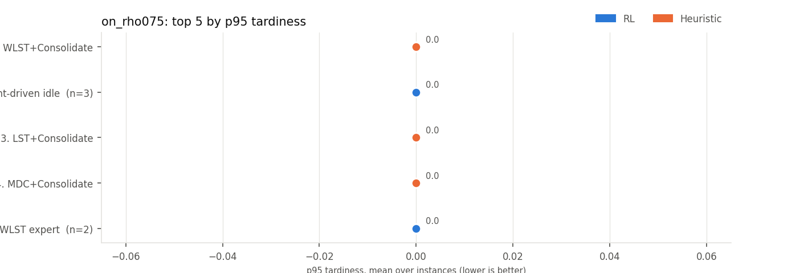 | 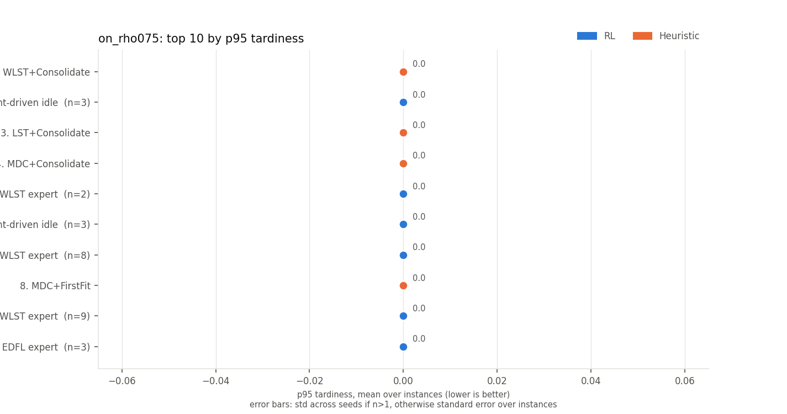 |

## mean wait (lower is better)

| rank | method | family | mean wait | J |
|---|---|---|---|---|
| 1 | SPT+Consolidate | Heuristic | 0.60 +/- 0.27 | 17647 +/- 18184 |
| 2 | WSPT+Consolidate | Heuristic | 0.65 +/- 0.30 | 13848 +/- 13952 |
| 3 | SPT+BestFit | Heuristic | 0.69 +/- 0.30 | 20689 +/- 19530 |
| 4 | WSPT+BestFit | Heuristic | 0.71 +/- 0.32 | 18358 +/- 19023 |
| 5 | ATC+Consolidate | Heuristic | 0.76 +/- 0.41 | 7109 +/- 5514 |
| 6 | PPO Opt3 ATC-prior score +Consolidate windowed +EDF imitation warm start look-ahead fixed scaling arrival-aware critic lateness shaping reward scaling event-driven idle ATC expert | RL | 0.76 +/- 0.00 | 7177 +/- 117 |
| 7 | FCFS+Consolidate | Heuristic | 0.78 +/- 0.46 | 7011 +/- 4969 |
| 8 | SPT+FirstFit | Heuristic | 0.81 +/- 0.31 | 26165 +/- 22870 |
| 9 | FCFS+BestFit | Heuristic | 0.81 +/- 0.44 | 7431 +/- 5297 |
| 10 | EDF+Consolidate | Heuristic | 0.84 +/- 0.52 | 6181 +/- 4022 |

| top 5 | top 10 |
|---|---|
| 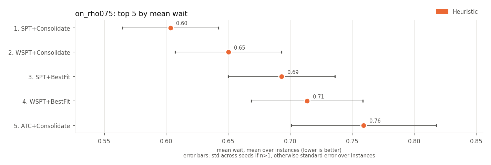 | 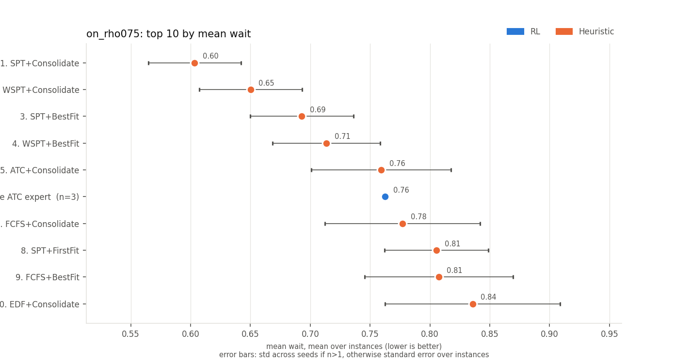 |

## mean flow time (lower is better)

| rank | method | family | mean flow time | J |
|---|---|---|---|---|
| 1 | SPT+Consolidate | Heuristic | 6.03 +/- 0.42 | 17647 +/- 18184 |
| 2 | WSPT+Consolidate | Heuristic | 6.07 +/- 0.44 | 13848 +/- 13952 |
| 3 | SPT+BestFit | Heuristic | 6.12 +/- 0.45 | 20689 +/- 19530 |
| 4 | WSPT+BestFit | Heuristic | 6.14 +/- 0.44 | 18358 +/- 19023 |
| 5 | ATC+Consolidate | Heuristic | 6.18 +/- 0.55 | 7109 +/- 5514 |
| 6 | PPO Opt3 ATC-prior score +Consolidate windowed +EDF imitation warm start look-ahead fixed scaling arrival-aware critic lateness shaping reward scaling event-driven idle ATC expert | RL | 6.19 +/- 0.00 | 7177 +/- 117 |
| 7 | FCFS+Consolidate | Heuristic | 6.20 +/- 0.57 | 7011 +/- 4969 |
| 8 | SPT+FirstFit | Heuristic | 6.23 +/- 0.43 | 26165 +/- 22870 |
| 9 | FCFS+BestFit | Heuristic | 6.23 +/- 0.57 | 7431 +/- 5297 |
| 10 | EDF+Consolidate | Heuristic | 6.26 +/- 0.65 | 6181 +/- 4022 |

| top 5 | top 10 |
|---|---|
| 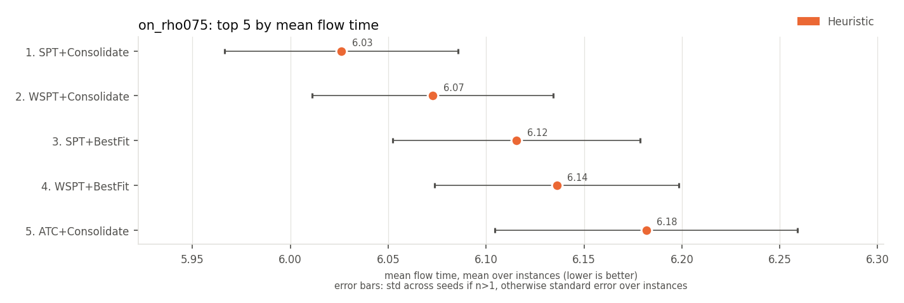 | 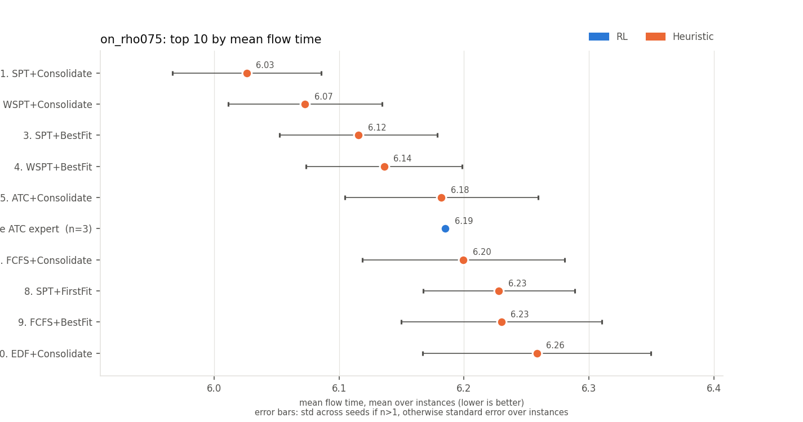 |

## makespan (lower is better)

| rank | method | family | makespan | J |
|---|---|---|---|---|
| 1 | LPT+BestFit | Heuristic | 129.7 +/- 6.5 | 25631 +/- 30944 |
| 2 | LPT+Consolidate | Heuristic | 129.8 +/- 6.4 | 21443 +/- 27215 |
| 3 | PPO Opt2 priority score +Consolidate windowed +EDF imitation warm start look-ahead fixed scaling arrival-aware critic lateness shaping reward scaling event-driven idle 1M-step budget WLST expert | RL | 129.9 +/- 0.1 | 6129 +/- 116 |
| 4 | LPT+FirstFit | Heuristic | 129.9 +/- 6.3 | 26058 +/- 28478 |
| 5 | PPO Opt2 priority score +Consolidate +EDF imitation warm start look-ahead fixed scaling arrival-aware critic lateness shaping reward scaling event-driven idle WLST expert | RL | 129.9 +/- 0.2 | 6092 +/- 61 |
| 6 | LST+Consolidate | Heuristic | 130.0 +/- 6.4 | 6051 +/- 4035 |
| 7 | PPO Opt2 priority score +Consolidate windowed MDC expert +EDF imitation warm start look-ahead fixed scaling arrival-aware critic lateness shaping reward scaling event-driven idle | RL | 130.0 +/- 0.1 | 6045 +/- 51 |
| 8 | PPO Opt2 priority score +Consolidate windowed COVERT expert +EDF imitation warm start look-ahead fixed scaling arrival-aware critic lateness shaping reward scaling event-driven idle | RL | 130.0 +/- 0.1 | 6122 +/- 117 |
| 9 | MDC+Consolidate | Heuristic | 130.0 +/- 6.5 | 6068 +/- 4037 |
| 10 | PPO Opt2 priority score +Consolidate windowed WLST expert +EDF imitation warm start look-ahead fixed scaling arrival-aware critic lateness shaping reward scaling event-driven idle | RL | 130.0 +/- 0.1 | 6174 +/- 152 |

| top 5 | top 10 |
|---|---|
| 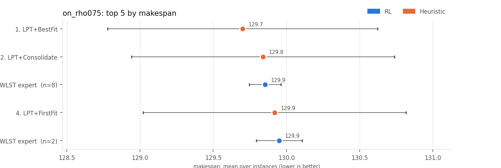 | 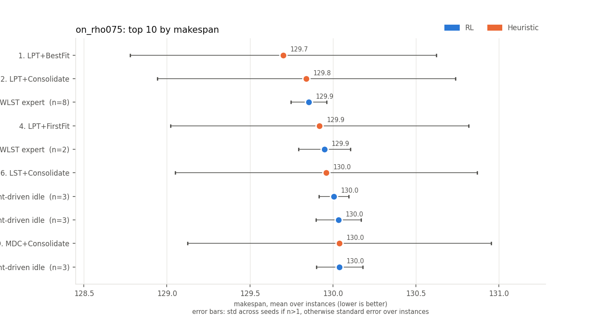 |

## utilisation of active machines (higher is better)

| rank | method | family | utilisation of active machines | J |
|---|---|---|---|---|
| 1 | LPT+Consolidate | Heuristic | 0.916 +/- 0.017 | 21443 +/- 27215 |
| 2 | PPO Opt2 priority score +Consolidate windowed COVERT expert +EDF imitation warm start look-ahead fixed scaling arrival-aware critic lateness shaping reward scaling event-driven idle | RL | 0.912 +/- 0.002 | 6122 +/- 117 |
| 3 | PPO Opt2 priority score +Consolidate windowed MDC expert +EDF imitation warm start look-ahead fixed scaling arrival-aware critic lateness shaping reward scaling event-driven idle | RL | 0.912 +/- 0.001 | 6045 +/- 51 |
| 4 | MDC+Consolidate | Heuristic | 0.912 +/- 0.018 | 6068 +/- 4037 |
| 5 | LST+Consolidate | Heuristic | 0.911 +/- 0.018 | 6051 +/- 4035 |
| 6 | PPO Opt2 priority score +Consolidate windowed +EDF imitation warm start look-ahead fixed scaling arrival-aware critic lateness shaping reward scaling event-driven idle 1M-step budget WLST expert | RL | 0.911 +/- 0.002 | 6129 +/- 116 |
| 7 | COVERT+Consolidate | Heuristic | 0.911 +/- 0.018 | 6219 +/- 4449 |
| 8 | PPO Opt2 priority score +Consolidate +EDF imitation warm start look-ahead fixed scaling arrival-aware critic lateness shaping reward scaling event-driven idle WLST expert | RL | 0.910 +/- 0.000 | 6092 +/- 61 |
| 9 | PPO Opt2 priority score +Consolidate windowed +EDF imitation warm start look-ahead fixed scaling arrival-aware critic lateness shaping reward scaling event-driven idle WLST expert | RL | 0.910 +/- 0.001 | 6157 +/- 93 |
| 10 | WLST+Consolidate | Heuristic | 0.909 +/- 0.019 | 5990 +/- 3881 |

| top 5 | top 10 |
|---|---|
| 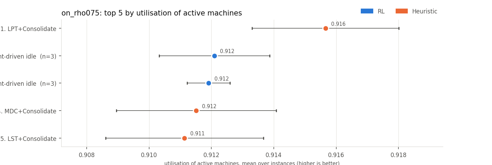 | 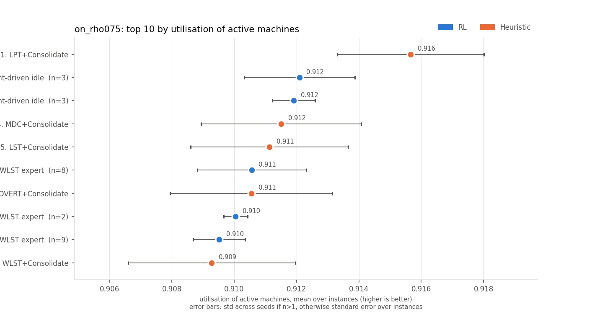 |

## active machine-ticks (lower is better)

| rank | method | family | active machine-ticks | J |
|---|---|---|---|---|
| 1 | LPT+Consolidate | Heuristic | 1073 +/- 50 | 21443 +/- 27215 |
| 2 | MDC+Consolidate | Heuristic | 1079 +/- 47 | 6068 +/- 4037 |
| 3 | PPO Opt2 priority score +Consolidate windowed MDC expert +EDF imitation warm start look-ahead fixed scaling arrival-aware critic lateness shaping reward scaling event-driven idle | RL | 1080 +/- 1 | 6045 +/- 51 |
| 4 | LST+Consolidate | Heuristic | 1080 +/- 49 | 6051 +/- 4035 |
| 5 | PPO Opt2 priority score +Consolidate windowed COVERT expert +EDF imitation warm start look-ahead fixed scaling arrival-aware critic lateness shaping reward scaling event-driven idle | RL | 1080 +/- 2 | 6122 +/- 117 |
| 6 | PPO Opt2 priority score +Consolidate windowed +EDF imitation warm start look-ahead fixed scaling arrival-aware critic lateness shaping reward scaling event-driven idle 1M-step budget WLST expert | RL | 1081 +/- 3 | 6129 +/- 116 |
| 7 | PPO Opt2 priority score +Consolidate +EDF imitation warm start look-ahead fixed scaling arrival-aware critic lateness shaping reward scaling event-driven idle WLST expert | RL | 1082 +/- 1 | 6092 +/- 61 |
| 8 | COVERT+Consolidate | Heuristic | 1083 +/- 49 | 6219 +/- 4449 |
| 9 | PPO Opt2 priority score +Consolidate windowed +EDF imitation warm start look-ahead fixed scaling arrival-aware critic lateness shaping reward scaling event-driven idle WLST expert | RL | 1083 +/- 1 | 6157 +/- 93 |
| 10 | WLST+Consolidate | Heuristic | 1083 +/- 49 | 5990 +/- 3881 |

| top 5 | top 10 |
|---|---|
| 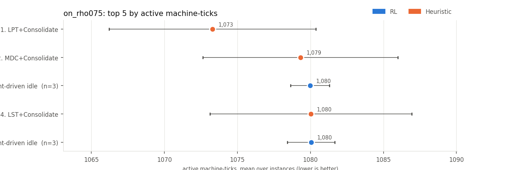 | 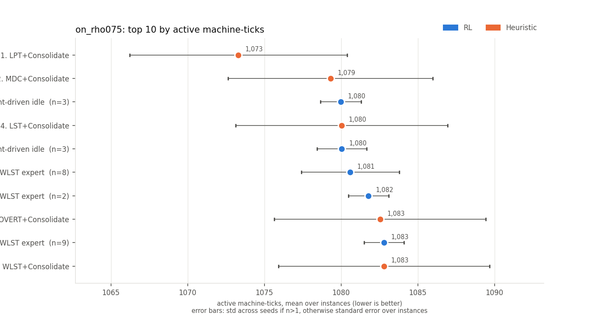 |

## energy (SPECpower) (lower is better)

| rank | method | family | energy (SPECpower) | J |
|---|---|---|---|---|
| 1 | LPT+Consolidate | Heuristic | 961 +/- 47 | 21443 +/- 27215 |
| 2 | MDC+Consolidate | Heuristic | 965 +/- 45 | 6068 +/- 4037 |
| 3 | PPO Opt2 priority score +Consolidate windowed MDC expert +EDF imitation warm start look-ahead fixed scaling arrival-aware critic lateness shaping reward scaling event-driven idle | RL | 966 +/- 1 | 6045 +/- 51 |
| 4 | LST+Consolidate | Heuristic | 966 +/- 45 | 6051 +/- 4035 |
| 5 | PPO Opt2 priority score +Consolidate windowed COVERT expert +EDF imitation warm start look-ahead fixed scaling arrival-aware critic lateness shaping reward scaling event-driven idle | RL | 966 +/- 1 | 6122 +/- 117 |
| 6 | PPO Opt2 priority score +Consolidate windowed +EDF imitation warm start look-ahead fixed scaling arrival-aware critic lateness shaping reward scaling event-driven idle 1M-step budget WLST expert | RL | 966 +/- 2 | 6129 +/- 116 |
| 7 | PPO Opt2 priority score +Consolidate +EDF imitation warm start look-ahead fixed scaling arrival-aware critic lateness shaping reward scaling event-driven idle WLST expert | RL | 967 +/- 1 | 6092 +/- 61 |
| 8 | COVERT+Consolidate | Heuristic | 967 +/- 45 | 6219 +/- 4449 |
| 9 | PPO Opt2 priority score +Consolidate windowed +EDF imitation warm start look-ahead fixed scaling arrival-aware critic lateness shaping reward scaling event-driven idle WLST expert | RL | 968 +/- 1 | 6157 +/- 93 |
| 10 | WLST+Consolidate | Heuristic | 968 +/- 45 | 5990 +/- 3881 |

| top 5 | top 10 |
|---|---|
| 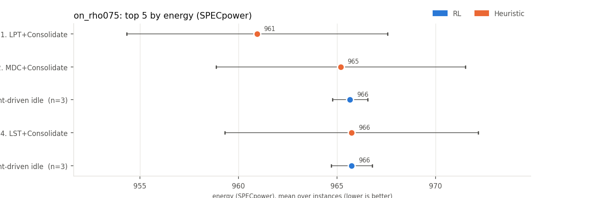 | 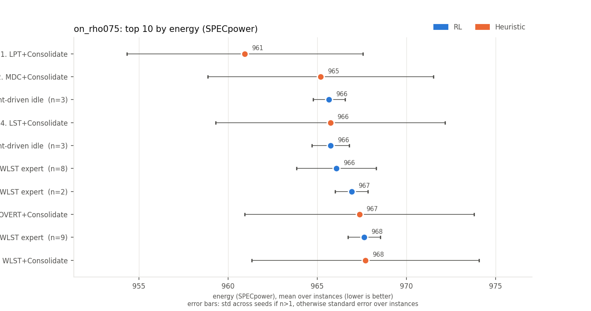 |

Spread (+/-): std across seeds for multi-seed RL rows, otherwise std across instances.
