# on_rho075_tight: leaderboards

Top 10 methods on each metric. Full ranking by J: [`tables/on_rho075_tight.md`](../tables/on_rho075_tight.md). Archive overview: [`HIGHLIGHTS.md`](../HIGHLIGHTS.md).

## J (lower is better)

| rank | method | family | J |
|---|---|---|---|
| 1 | WLST+Consolidate | Heuristic | 29502 +/- 10035 |
| 2 | MDC+Consolidate | Heuristic | 29749 +/- 10416 |
| 3 | LST+Consolidate | Heuristic | 29975 +/- 10819 |
| 4 | PPO Opt2 priority score +Consolidate windowed WLST expert +EDF imitation warm start look-ahead fixed scaling arrival-aware critic lateness shaping reward scaling event-driven idle | RL | 30044 +/- 501 |
| 5 | PPO Opt2 priority score +Consolidate windowed +EDF imitation warm start look-ahead fixed scaling arrival-aware critic lateness shaping reward scaling event-driven idle WLST expert | RL | 30056 +/- 338 |
| 6 | PPO Opt2 priority score +Consolidate windowed +EDF imitation warm start look-ahead fixed scaling arrival-aware critic lateness shaping reward scaling event-driven idle 1M-step budget WLST expert | RL | 30072 +/- 474 |
| 7 | PPO Opt2 priority score +Consolidate windowed MDC expert +EDF imitation warm start look-ahead fixed scaling arrival-aware critic lateness shaping reward scaling event-driven idle | RL | 30147 +/- 256 |
| 8 | WEDF+Consolidate | Heuristic | 30476 +/- 10271 |
| 9 | PPO Opt2 priority score +Consolidate windowed COVERT expert +EDF imitation warm start look-ahead fixed scaling arrival-aware critic lateness shaping reward scaling event-driven idle | RL | 30759 +/- 368 |
| 10 | EDF+Consolidate | Heuristic | 31101 +/- 11371 |

| top 5 | top 10 |
|---|---|
| 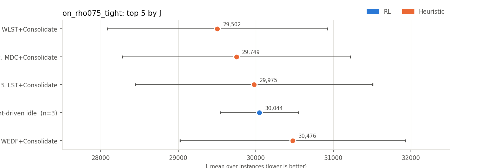 | 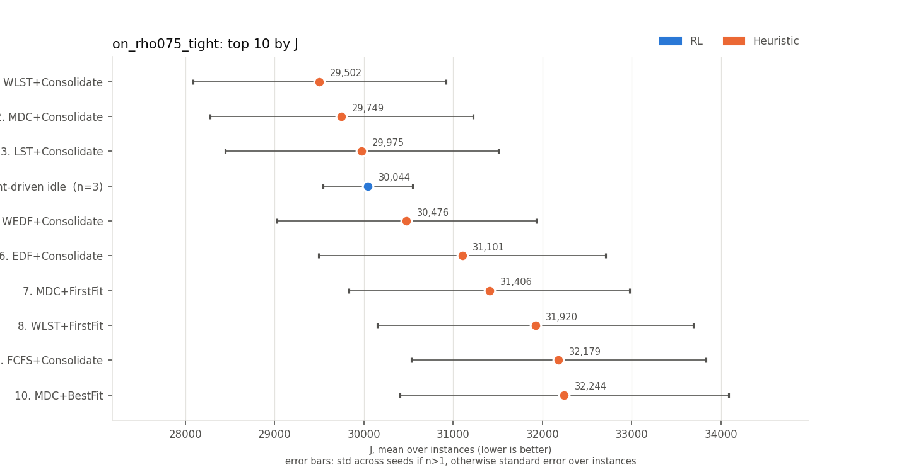 |

## on-time rate (higher is better)

| rank | method | family | on-time rate | J |
|---|---|---|---|---|
| 1 | ATC+Consolidate | Heuristic | 0.887 +/- 0.015 | 41078 +/- 22264 |
| 2 | PPO Opt3 ATC-prior score +Consolidate windowed +EDF imitation warm start look-ahead fixed scaling arrival-aware critic lateness shaping reward scaling event-driven idle ATC expert | RL | 0.885 +/- 0.001 | 40569 +/- 21 |
| 3 | ATC+BestFit | Heuristic | 0.884 +/- 0.015 | 45653 +/- 27837 |
| 4 | EDF+Consolidate | Heuristic | 0.884 +/- 0.021 | 31101 +/- 11371 |
| 5 | PPO Opt2 priority score +Consolidate windowed COVERT expert +EDF imitation warm start look-ahead fixed scaling arrival-aware critic lateness shaping reward scaling event-driven idle | RL | 0.884 +/- 0.001 | 30759 +/- 368 |
| 6 | SPT+Consolidate | Heuristic | 0.884 +/- 0.015 | 52486 +/- 31580 |
| 7 | PPO Opt2 priority score +Consolidate windowed +EDF imitation warm start look-ahead fixed scaling arrival-aware critic lateness shaping reward scaling event-driven idle EDFL expert | RL | 0.882 +/- 0.000 | 31260 +/- 235 |
| 8 | WSPT+Consolidate | Heuristic | 0.882 +/- 0.015 | 46188 +/- 26154 |
| 9 | LST+Consolidate | Heuristic | 0.882 +/- 0.022 | 29975 +/- 10819 |
| 10 | PPO Opt2 priority score +Consolidate windowed MDC expert +EDF imitation warm start look-ahead fixed scaling arrival-aware critic lateness shaping reward scaling event-driven idle | RL | 0.882 +/- 0.000 | 30147 +/- 256 |

| top 5 | top 10 |
|---|---|
| 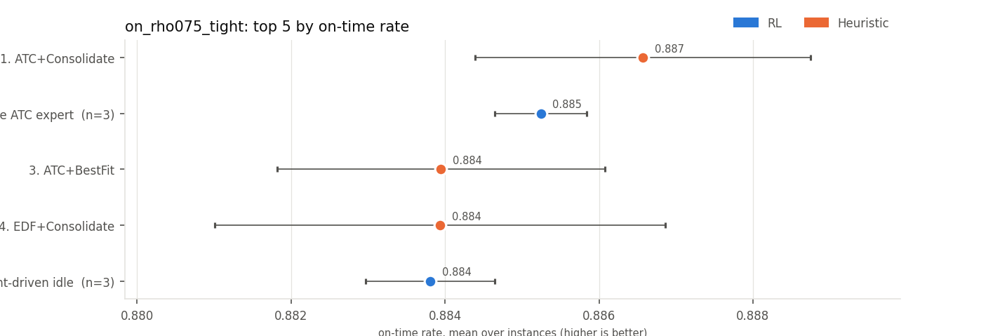 | 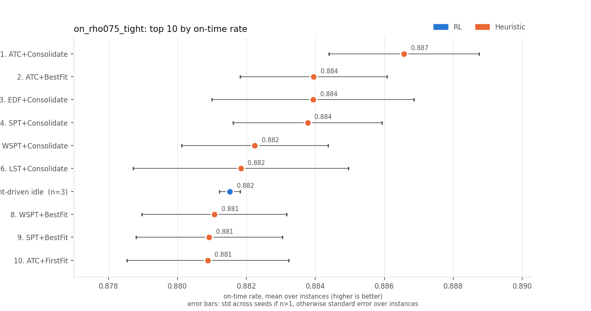 |

## late jobs (lower is better)

| rank | method | family | late jobs | J |
|---|---|---|---|---|
| 1 | ATC+Consolidate | Heuristic | 81.1 +/- 11.6 | 41078 +/- 22264 |
| 2 | PPO Opt3 ATC-prior score +Consolidate windowed +EDF imitation warm start look-ahead fixed scaling arrival-aware critic lateness shaping reward scaling event-driven idle ATC expert | RL | 82.1 +/- 0.4 | 40569 +/- 21 |
| 3 | ATC+BestFit | Heuristic | 83.0 +/- 11.4 | 45653 +/- 27837 |
| 4 | EDF+Consolidate | Heuristic | 83.1 +/- 15.8 | 31101 +/- 11371 |
| 5 | SPT+Consolidate | Heuristic | 83.1 +/- 11.6 | 52486 +/- 31580 |
| 6 | PPO Opt2 priority score +Consolidate windowed COVERT expert +EDF imitation warm start look-ahead fixed scaling arrival-aware critic lateness shaping reward scaling event-driven idle | RL | 83.2 +/- 0.6 | 30759 +/- 368 |
| 7 | PPO Opt2 priority score +Consolidate windowed +EDF imitation warm start look-ahead fixed scaling arrival-aware critic lateness shaping reward scaling event-driven idle EDFL expert | RL | 84.3 +/- 0.2 | 31260 +/- 235 |
| 8 | WSPT+Consolidate | Heuristic | 84.3 +/- 11.9 | 46188 +/- 26154 |
| 9 | LST+Consolidate | Heuristic | 84.6 +/- 16.8 | 29975 +/- 10819 |
| 10 | PPO Opt2 priority score +Consolidate windowed MDC expert +EDF imitation warm start look-ahead fixed scaling arrival-aware critic lateness shaping reward scaling event-driven idle | RL | 84.9 +/- 0.2 | 30147 +/- 256 |

| top 5 | top 10 |
|---|---|
| 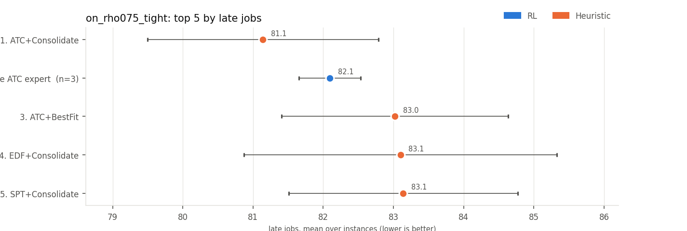 | 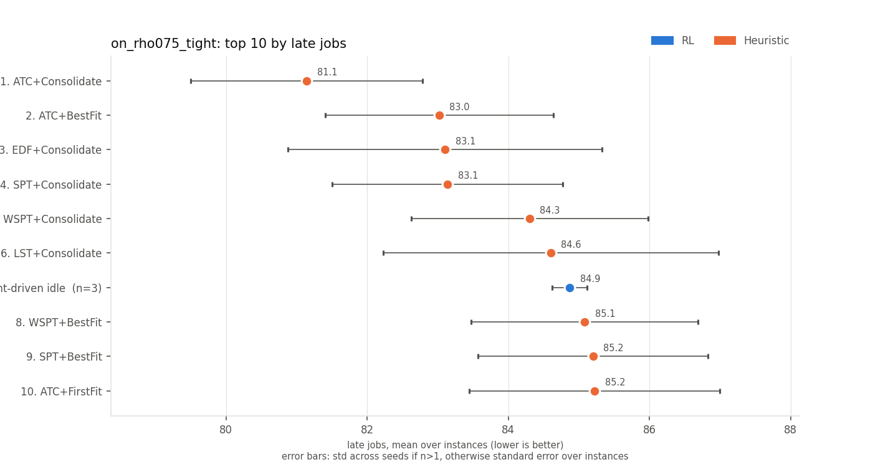 |

## weighted late jobs (lower is better)

| rank | method | family | weighted late jobs | J |
|---|---|---|---|---|
| 1 | PPO Opt3 ATC-prior score +Consolidate windowed +EDF imitation warm start look-ahead fixed scaling arrival-aware critic lateness shaping reward scaling event-driven idle ATC expert | RL | 236.3 +/- 1.2 | 40569 +/- 21 |
| 2 | PPO Opt2 priority score +Consolidate windowed COVERT expert +EDF imitation warm start look-ahead fixed scaling arrival-aware critic lateness shaping reward scaling event-driven idle | RL | 244.3 +/- 0.7 | 30759 +/- 368 |
| 3 | PPO Opt2 priority score +Consolidate windowed WLST expert +EDF imitation warm start look-ahead fixed scaling arrival-aware critic lateness shaping reward scaling event-driven idle | RL | 250.2 +/- 0.9 | 30044 +/- 501 |
| 4 | PPO Opt2 priority score +Consolidate windowed +EDF imitation warm start look-ahead fixed scaling arrival-aware critic lateness shaping reward scaling event-driven idle EDFL expert | RL | 251.3 +/- 0.6 | 31260 +/- 235 |
| 5 | PPO Opt2 priority score +Consolidate windowed +EDF imitation warm start look-ahead fixed scaling arrival-aware critic lateness shaping reward scaling event-driven idle WLST expert | RL | 251.8 +/- 1.7 | 30056 +/- 338 |
| 6 | PPO Opt2 priority score +Consolidate windowed MDC expert +EDF imitation warm start look-ahead fixed scaling arrival-aware critic lateness shaping reward scaling event-driven idle | RL | 252.5 +/- 0.4 | 30147 +/- 256 |
| 7 | PPO Opt2 priority score +Consolidate windowed +EDF imitation warm start look-ahead fixed scaling arrival-aware critic lateness shaping reward scaling event-driven idle 1M-step budget WLST expert | RL | 254.2 +/- 3.7 | 30072 +/- 474 |
| 8 | PPO Opt3 ATC-prior score +Consolidate windowed look-ahead fixed scaling arrival-aware critic lateness shaping reward scaling event-driven idle 1M-step budget | RL | 271.1 +/- 8.7 | 38685 +/- 2429 |
| 9 | PPO Opt2 priority score +Consolidate windowed look-ahead fixed scaling arrival-aware critic lateness shaping reward scaling event-driven idle 1M-step budget | RL | 275.2 +/- 2.2 | 38395 +/- 1981 |

| top 5 |
|---|
| 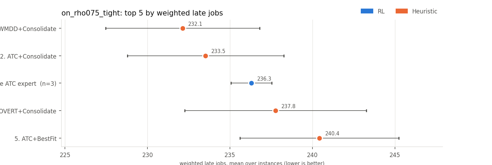 |

## weighted tardiness (lower is better)

| rank | method | family | weighted tardiness | J |
|---|---|---|---|---|
| 1 | MDC+Consolidate | Heuristic | 1966 +/- 501 | 29749 +/- 10416 |
| 2 | PPO Opt2 priority score +Consolidate windowed COVERT expert +EDF imitation warm start look-ahead fixed scaling arrival-aware critic lateness shaping reward scaling event-driven idle | RL | 1968 +/- 12 | 30759 +/- 368 |
| 3 | WLST+Consolidate | Heuristic | 1973 +/- 493 | 29502 +/- 10035 |
| 4 | WEDF+Consolidate | Heuristic | 1985 +/- 484 | 30476 +/- 10271 |
| 5 | PPO Opt2 priority score +Consolidate windowed WLST expert +EDF imitation warm start look-ahead fixed scaling arrival-aware critic lateness shaping reward scaling event-driven idle | RL | 1986 +/- 18 | 30044 +/- 501 |
| 6 | LST+Consolidate | Heuristic | 1989 +/- 535 | 29975 +/- 10819 |
| 7 | PPO Opt2 priority score +Consolidate windowed +EDF imitation warm start look-ahead fixed scaling arrival-aware critic lateness shaping reward scaling event-driven idle WLST expert | RL | 1990 +/- 12 | 30056 +/- 338 |
| 8 | PPO Opt2 priority score +Consolidate windowed MDC expert +EDF imitation warm start look-ahead fixed scaling arrival-aware critic lateness shaping reward scaling event-driven idle | RL | 2000 +/- 5 | 30147 +/- 256 |
| 9 | PPO Opt2 priority score +Consolidate windowed +EDF imitation warm start look-ahead fixed scaling arrival-aware critic lateness shaping reward scaling event-driven idle 1M-step budget WLST expert | RL | 2002 +/- 31 | 30072 +/- 474 |
| 10 | EDF+Consolidate | Heuristic | 2008 +/- 503 | 31101 +/- 11371 |

| top 5 | top 10 |
|---|---|
| 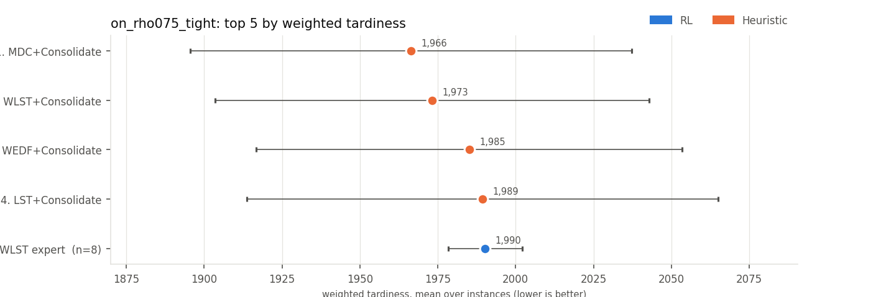 | 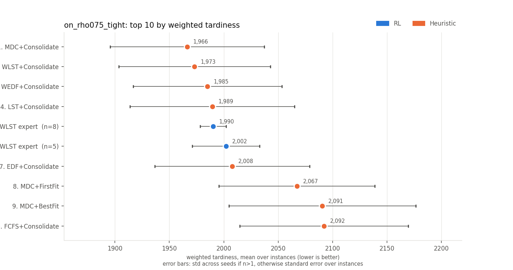 |

## max tardiness (lower is better)

| rank | method | family | max tardiness | J |
|---|---|---|---|---|
| 1 | PPO Opt2 priority score +Consolidate windowed +EDF imitation warm start look-ahead fixed scaling arrival-aware critic lateness shaping reward scaling event-driven idle WLST expert | RL | 32.7 +/- 0.1 | 30056 +/- 338 |
| 2 | PPO Opt2 priority score +Consolidate windowed +EDF imitation warm start look-ahead fixed scaling arrival-aware critic lateness shaping reward scaling event-driven idle 1M-step budget WLST expert | RL | 32.8 +/- 0.1 | 30072 +/- 474 |
| 3 | PPO Opt2 priority score +Consolidate windowed WLST expert +EDF imitation warm start look-ahead fixed scaling arrival-aware critic lateness shaping reward scaling event-driven idle | RL | 32.8 +/- 0.2 | 30044 +/- 501 |
| 4 | LST+Consolidate | Heuristic | 32.9 +/- 3.1 | 29975 +/- 10819 |
| 5 | WLST+Consolidate | Heuristic | 33.0 +/- 3.5 | 29502 +/- 10035 |
| 6 | LST+FirstFit | Heuristic | 33.0 +/- 3.5 | 32262 +/- 13031 |
| 7 | PPO Opt2 priority score +Consolidate windowed MDC expert +EDF imitation warm start look-ahead fixed scaling arrival-aware critic lateness shaping reward scaling event-driven idle | RL | 33.0 +/- 0.2 | 30147 +/- 256 |
| 8 | MDC+Consolidate | Heuristic | 33.1 +/- 3.3 | 29749 +/- 10416 |
| 9 | LST+BestFit | Heuristic | 33.3 +/- 4.5 | 33192 +/- 15481 |
| 10 | EDF+Consolidate | Heuristic | 33.4 +/- 3.9 | 31101 +/- 11371 |

| top 5 | top 10 |
|---|---|
| 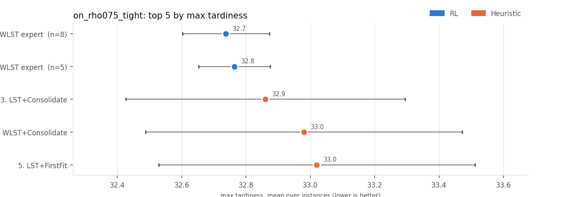 | 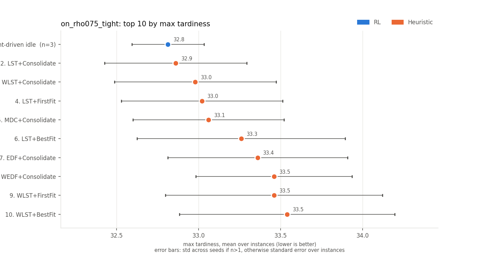 |

## p95 tardiness (lower is better)

| rank | method | family | p95 tardiness | J |
|---|---|---|---|---|
| 1 | MDC+Consolidate | Heuristic | 6.2 +/- 1.8 | 29749 +/- 10416 |
| 2 | PPO Opt2 priority score +Consolidate windowed COVERT expert +EDF imitation warm start look-ahead fixed scaling arrival-aware critic lateness shaping reward scaling event-driven idle | RL | 6.3 +/- 0.1 | 30759 +/- 368 |
| 3 | LST+Consolidate | Heuristic | 6.4 +/- 2.0 | 29975 +/- 10819 |
| 4 | PPO Opt2 priority score +Consolidate windowed MDC expert +EDF imitation warm start look-ahead fixed scaling arrival-aware critic lateness shaping reward scaling event-driven idle | RL | 6.4 +/- 0.0 | 30147 +/- 256 |
| 5 | EDF+Consolidate | Heuristic | 6.4 +/- 1.8 | 31101 +/- 11371 |
| 6 | PPO Opt2 priority score +Consolidate windowed +EDF imitation warm start look-ahead fixed scaling arrival-aware critic lateness shaping reward scaling event-driven idle 1M-step budget WLST expert | RL | 6.4 +/- 0.1 | 30072 +/- 474 |
| 7 | WLST+Consolidate | Heuristic | 6.4 +/- 1.8 | 29502 +/- 10035 |
| 8 | PPO Opt2 priority score +Consolidate windowed +EDF imitation warm start look-ahead fixed scaling arrival-aware critic lateness shaping reward scaling event-driven idle EDFL expert | RL | 6.5 +/- 0.1 | 31260 +/- 235 |
| 9 | MDC+FirstFit | Heuristic | 6.6 +/- 1.7 | 31406 +/- 11125 |
| 10 | PPO Opt2 priority score +Consolidate windowed WLST expert +EDF imitation warm start look-ahead fixed scaling arrival-aware critic lateness shaping reward scaling event-driven idle | RL | 6.6 +/- 0.2 | 30044 +/- 501 |

| top 5 | top 10 |
|---|---|
| 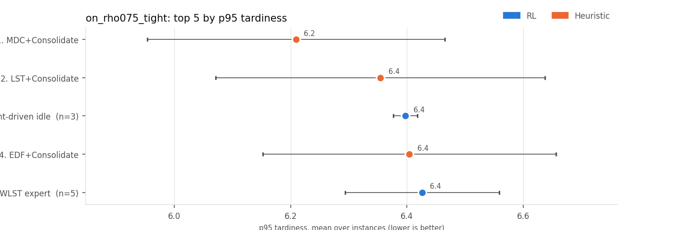 | 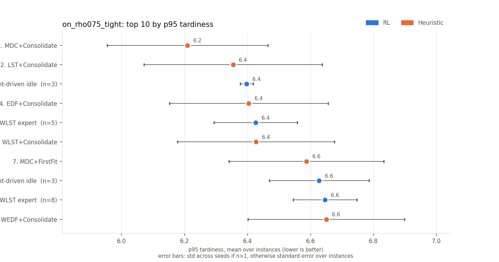 |

## mean wait (lower is better)

| rank | method | family | mean wait | J |
|---|---|---|---|---|
| 1 | SPT+Consolidate | Heuristic | 0.60 +/- 0.27 | 52486 +/- 31580 |
| 2 | ATC+Consolidate | Heuristic | 0.64 +/- 0.29 | 41078 +/- 22264 |
| 3 | WSPT+Consolidate | Heuristic | 0.65 +/- 0.30 | 46188 +/- 26154 |
| 4 | PPO Opt3 ATC-prior score +Consolidate windowed +EDF imitation warm start look-ahead fixed scaling arrival-aware critic lateness shaping reward scaling event-driven idle ATC expert | RL | 0.66 +/- 0.01 | 40569 +/- 21 |
| 5 | SPT+BestFit | Heuristic | 0.69 +/- 0.30 | 58955 +/- 34820 |
| 6 | WSPT+BestFit | Heuristic | 0.71 +/- 0.32 | 54702 +/- 33567 |
| 7 | ATC+BestFit | Heuristic | 0.72 +/- 0.31 | 45653 +/- 27837 |
| 8 | FCFS+Consolidate | Heuristic | 0.78 +/- 0.46 | 32179 +/- 11674 |
| 9 | SPT+FirstFit | Heuristic | 0.81 +/- 0.31 | 68902 +/- 39184 |
| 10 | FCFS+BestFit | Heuristic | 0.81 +/- 0.44 | 34033 +/- 12531 |

| top 5 | top 10 |
|---|---|
| 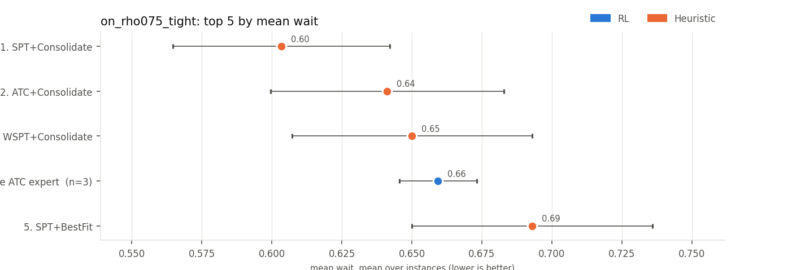 | 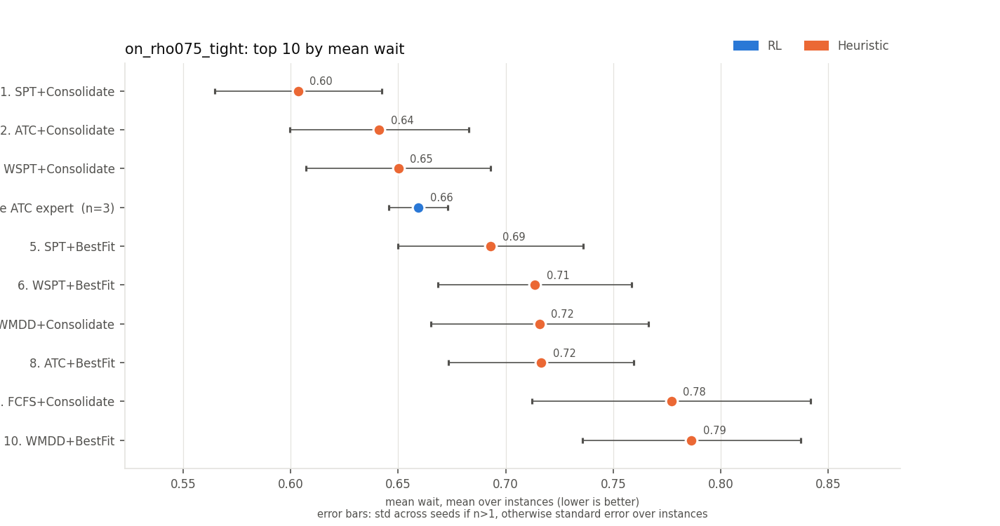 |

## mean flow time (lower is better)

| rank | method | family | mean flow time | J |
|---|---|---|---|---|
| 1 | SPT+Consolidate | Heuristic | 6.03 +/- 0.42 | 52486 +/- 31580 |
| 2 | ATC+Consolidate | Heuristic | 6.06 +/- 0.43 | 41078 +/- 22264 |
| 3 | WSPT+Consolidate | Heuristic | 6.07 +/- 0.44 | 46188 +/- 26154 |
| 4 | PPO Opt3 ATC-prior score +Consolidate windowed +EDF imitation warm start look-ahead fixed scaling arrival-aware critic lateness shaping reward scaling event-driven idle ATC expert | RL | 6.08 +/- 0.01 | 40569 +/- 21 |
| 5 | SPT+BestFit | Heuristic | 6.12 +/- 0.45 | 58955 +/- 34820 |
| 6 | WSPT+BestFit | Heuristic | 6.14 +/- 0.44 | 54702 +/- 33567 |
| 7 | ATC+BestFit | Heuristic | 6.14 +/- 0.44 | 45653 +/- 27837 |
| 8 | FCFS+Consolidate | Heuristic | 6.20 +/- 0.57 | 32179 +/- 11674 |
| 9 | SPT+FirstFit | Heuristic | 6.23 +/- 0.43 | 68902 +/- 39184 |
| 10 | FCFS+BestFit | Heuristic | 6.23 +/- 0.57 | 34033 +/- 12531 |

| top 5 | top 10 |
|---|---|
| 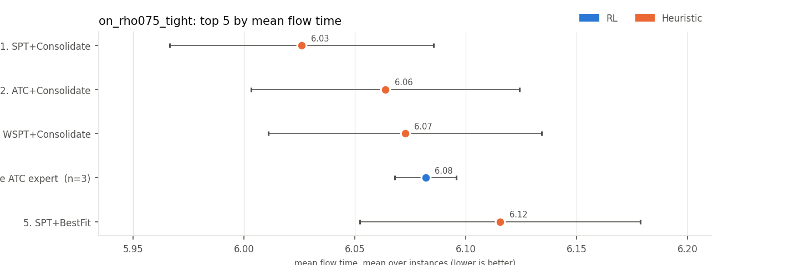 | 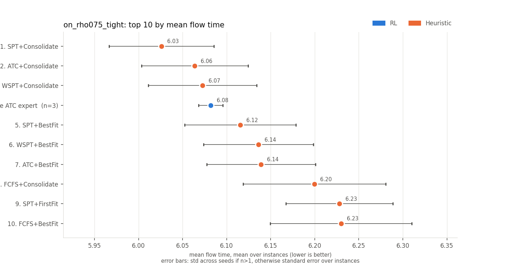 |

## makespan (lower is better)

| rank | method | family | makespan | J |
|---|---|---|---|---|
| 1 | LPT+BestFit | Heuristic | 129.7 +/- 6.5 | 75080 +/- 62264 |
| 2 | PPO Opt2 priority score +Consolidate windowed WLST expert +EDF imitation warm start look-ahead fixed scaling arrival-aware critic lateness shaping reward scaling event-driven idle | RL | 129.8 +/- 0.1 | 30044 +/- 501 |
| 3 | PPO Opt2 priority score +Consolidate windowed +EDF imitation warm start look-ahead fixed scaling arrival-aware critic lateness shaping reward scaling event-driven idle 1M-step budget WLST expert | RL | 129.8 +/- 0.1 | 30072 +/- 474 |
| 4 | PPO Opt2 priority score +Consolidate windowed +EDF imitation warm start look-ahead fixed scaling arrival-aware critic lateness shaping reward scaling event-driven idle WLST expert | RL | 129.8 +/- 0.1 | 30056 +/- 338 |
| 5 | WLST+Consolidate | Heuristic | 129.8 +/- 6.3 | 29502 +/- 10035 |
| 6 | LST+Consolidate | Heuristic | 129.8 +/- 6.4 | 29975 +/- 10819 |
| 7 | WLST+FirstFit | Heuristic | 129.8 +/- 6.4 | 31920 +/- 12527 |
| 8 | LPT+Consolidate | Heuristic | 129.8 +/- 6.4 | 64381 +/- 53835 |
| 9 | LST+FirstFit | Heuristic | 129.9 +/- 6.3 | 32262 +/- 13031 |
| 10 | LPT+FirstFit | Heuristic | 129.9 +/- 6.3 | 77120 +/- 59730 |

| top 5 | top 10 |
|---|---|
| 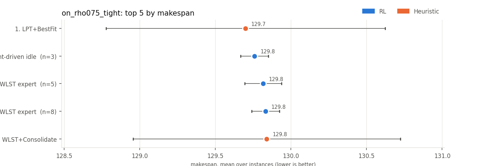 | 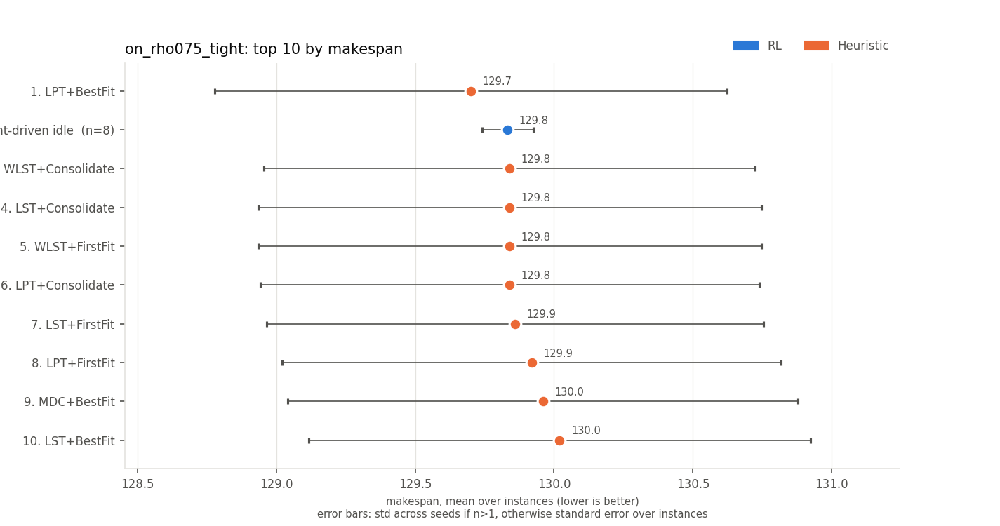 |

## utilisation of active machines (higher is better)

| rank | method | family | utilisation of active machines | J |
|---|---|---|---|---|
| 1 | LPT+Consolidate | Heuristic | 0.916 +/- 0.017 | 64381 +/- 53835 |
| 2 | PPO Opt2 priority score +Consolidate windowed WLST expert +EDF imitation warm start look-ahead fixed scaling arrival-aware critic lateness shaping reward scaling event-driven idle | RL | 0.914 +/- 0.001 | 30044 +/- 501 |
| 3 | PPO Opt2 priority score +Consolidate windowed +EDF imitation warm start look-ahead fixed scaling arrival-aware critic lateness shaping reward scaling event-driven idle 1M-step budget WLST expert | RL | 0.914 +/- 0.001 | 30072 +/- 474 |
| 4 | LST+Consolidate | Heuristic | 0.914 +/- 0.018 | 29975 +/- 10819 |
| 5 | PPO Opt2 priority score +Consolidate windowed +EDF imitation warm start look-ahead fixed scaling arrival-aware critic lateness shaping reward scaling event-driven idle WLST expert | RL | 0.913 +/- 0.001 | 30056 +/- 338 |
| 6 | PPO Opt2 priority score +Consolidate windowed MDC expert +EDF imitation warm start look-ahead fixed scaling arrival-aware critic lateness shaping reward scaling event-driven idle | RL | 0.913 +/- 0.001 | 30147 +/- 256 |
| 7 | PPO Opt2 priority score +Consolidate windowed COVERT expert +EDF imitation warm start look-ahead fixed scaling arrival-aware critic lateness shaping reward scaling event-driven idle | RL | 0.913 +/- 0.001 | 30759 +/- 368 |
| 8 | WLST+Consolidate | Heuristic | 0.912 +/- 0.019 | 29502 +/- 10035 |
| 9 | MDC+Consolidate | Heuristic | 0.912 +/- 0.020 | 29749 +/- 10416 |
| 10 | PPO Opt3 ATC-prior score +Consolidate windowed look-ahead fixed scaling arrival-aware critic lateness shaping reward scaling event-driven idle 1M-step budget | RL | 0.911 +/- 0.001 | 38685 +/- 2429 |

| top 5 | top 10 |
|---|---|
| 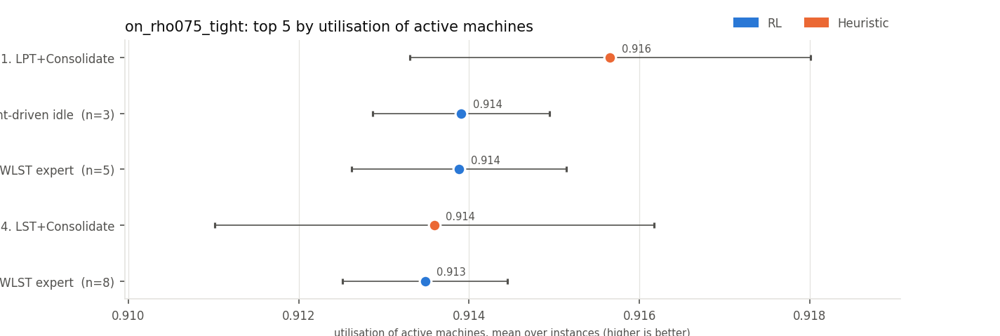 | 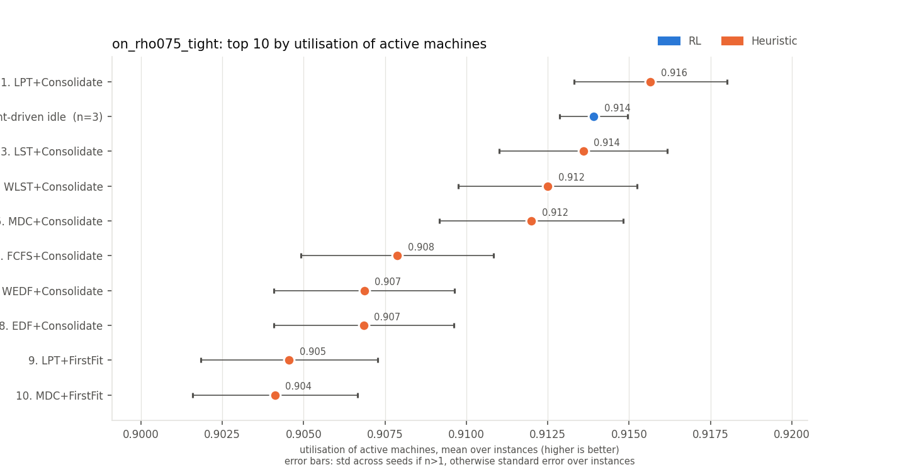 |

## active machine-ticks (lower is better)

| rank | method | family | active machine-ticks | J |
|---|---|---|---|---|
| 1 | LPT+Consolidate | Heuristic | 1073 +/- 50 | 64381 +/- 53835 |
| 2 | PPO Opt2 priority score +Consolidate windowed +EDF imitation warm start look-ahead fixed scaling arrival-aware critic lateness shaping reward scaling event-driven idle 1M-step budget WLST expert | RL | 1074 +/- 2 | 30072 +/- 474 |
| 3 | PPO Opt2 priority score +Consolidate windowed WLST expert +EDF imitation warm start look-ahead fixed scaling arrival-aware critic lateness shaping reward scaling event-driven idle | RL | 1074 +/- 1 | 30044 +/- 501 |
| 4 | LST+Consolidate | Heuristic | 1074 +/- 48 | 29975 +/- 10819 |
| 5 | PPO Opt2 priority score +Consolidate windowed +EDF imitation warm start look-ahead fixed scaling arrival-aware critic lateness shaping reward scaling event-driven idle WLST expert | RL | 1074 +/- 2 | 30056 +/- 338 |
| 6 | WLST+Consolidate | Heuristic | 1075 +/- 44 | 29502 +/- 10035 |
| 7 | PPO Opt2 priority score +Consolidate windowed MDC expert +EDF imitation warm start look-ahead fixed scaling arrival-aware critic lateness shaping reward scaling event-driven idle | RL | 1075 +/- 1 | 30147 +/- 256 |
| 8 | MDC+Consolidate | Heuristic | 1076 +/- 48 | 29749 +/- 10416 |
| 9 | PPO Opt2 priority score +Consolidate windowed COVERT expert +EDF imitation warm start look-ahead fixed scaling arrival-aware critic lateness shaping reward scaling event-driven idle | RL | 1078 +/- 2 | 30759 +/- 368 |
| 10 | PPO Opt3 ATC-prior score +Consolidate windowed look-ahead fixed scaling arrival-aware critic lateness shaping reward scaling event-driven idle 1M-step budget | RL | 1082 +/- 4 | 38685 +/- 2429 |

| top 5 | top 10 |
|---|---|
| 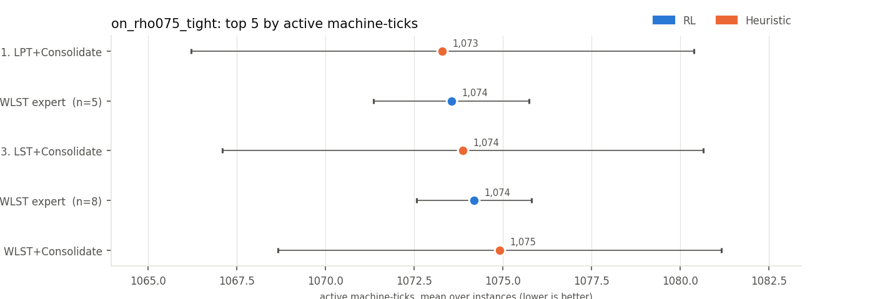 | 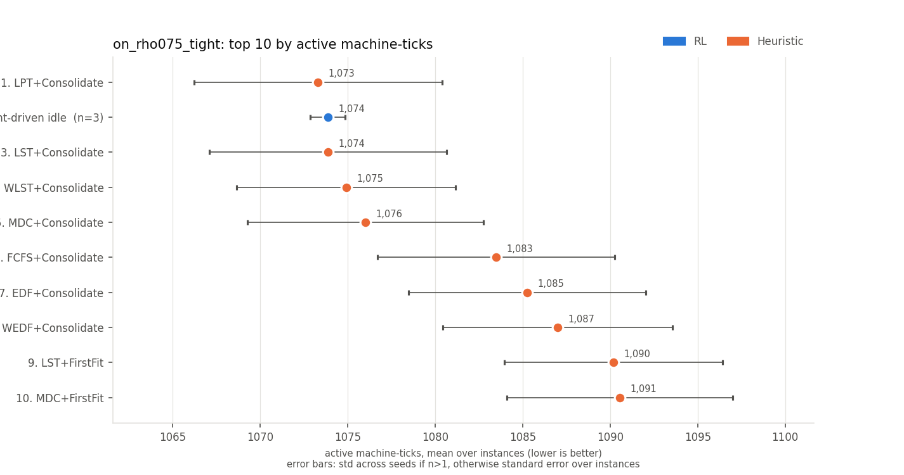 |

## energy (SPECpower) (lower is better)

| rank | method | family | energy (SPECpower) | J |
|---|---|---|---|---|
| 1 | LPT+Consolidate | Heuristic | 961 +/- 47 | 64381 +/- 53835 |
| 2 | PPO Opt2 priority score +Consolidate windowed +EDF imitation warm start look-ahead fixed scaling arrival-aware critic lateness shaping reward scaling event-driven idle 1M-step budget WLST expert | RL | 961 +/- 2 | 30072 +/- 474 |
| 3 | LST+Consolidate | Heuristic | 961 +/- 45 | 29975 +/- 10819 |
| 4 | PPO Opt2 priority score +Consolidate windowed WLST expert +EDF imitation warm start look-ahead fixed scaling arrival-aware critic lateness shaping reward scaling event-driven idle | RL | 961 +/- 1 | 30044 +/- 501 |
| 5 | PPO Opt2 priority score +Consolidate windowed +EDF imitation warm start look-ahead fixed scaling arrival-aware critic lateness shaping reward scaling event-driven idle WLST expert | RL | 962 +/- 1 | 30056 +/- 338 |
| 6 | WLST+Consolidate | Heuristic | 962 +/- 42 | 29502 +/- 10035 |
| 7 | PPO Opt2 priority score +Consolidate windowed MDC expert +EDF imitation warm start look-ahead fixed scaling arrival-aware critic lateness shaping reward scaling event-driven idle | RL | 962 +/- 1 | 30147 +/- 256 |
| 8 | MDC+Consolidate | Heuristic | 963 +/- 45 | 29749 +/- 10416 |
| 9 | PPO Opt2 priority score +Consolidate windowed COVERT expert +EDF imitation warm start look-ahead fixed scaling arrival-aware critic lateness shaping reward scaling event-driven idle | RL | 964 +/- 1 | 30759 +/- 368 |
| 10 | PPO Opt3 ATC-prior score +Consolidate windowed look-ahead fixed scaling arrival-aware critic lateness shaping reward scaling event-driven idle 1M-step budget | RL | 967 +/- 3 | 38685 +/- 2429 |

| top 5 | top 10 |
|---|---|
| 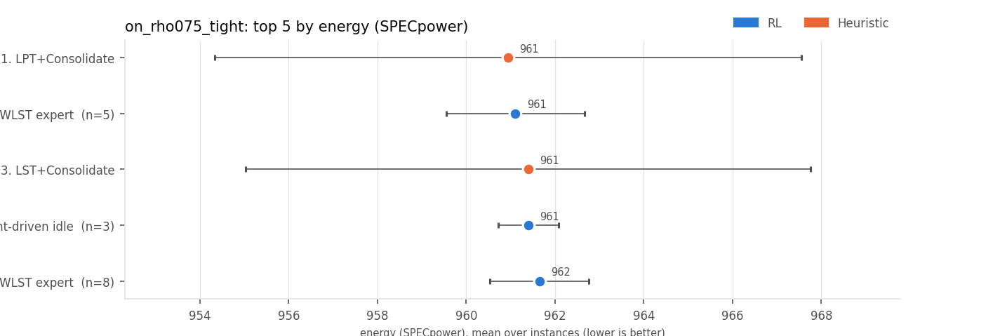 | 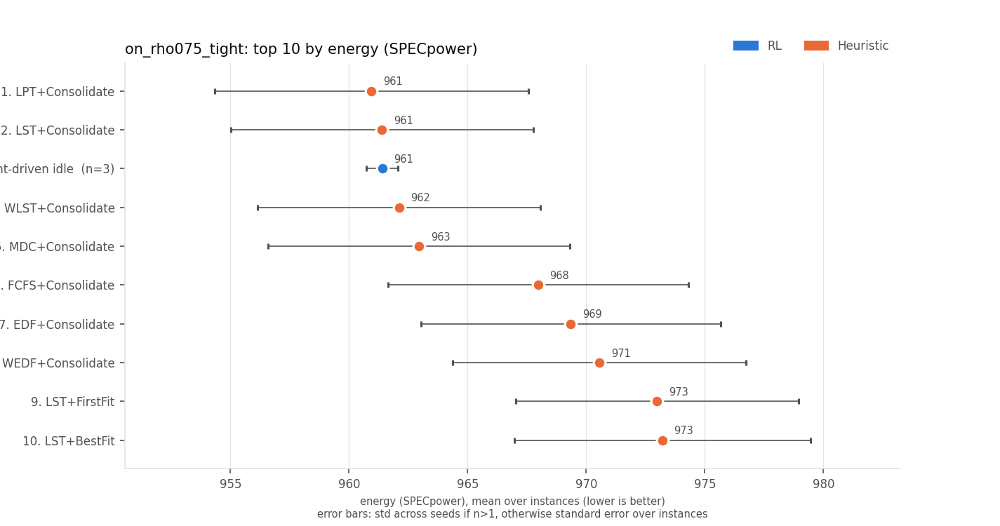 |

Spread (+/-): std across seeds for multi-seed RL rows, otherwise std across instances.
